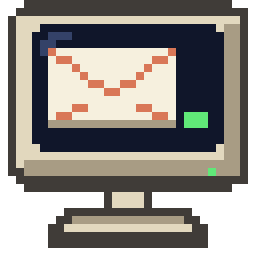
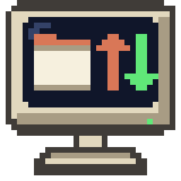
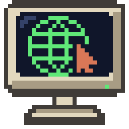
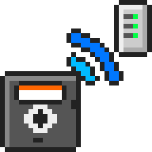

# AERA-Atari

How the AERA programs for Atari computers look and behave, and the files and code they share. Every
AERA app repo follows what's here, so the programs feel like one family on the Atari and on GitHub.

## The family

| | Program | For | What it is |
|---|---|---|---|
|  | [ECal](https://github.com/whomper/ECal) | ST, STE, TT, Falcon | calendar desk accessory; iCloud and CalDAV |
|  | [EContact](https://github.com/whomper/EContact) | ST, STE, TT, Falcon | contacts desk accessory; CardDAV |
|  | [EMail](https://github.com/whomper/EMail) | ST, STE, TT, Falcon | IMAP, POP3 and SMTP mail |
|  | [EFTP](https://github.com/whomper/EFTP) | ST, STE, TT, Falcon | two-pane FTP, FTPS and SFTP |
|  | [EHypView](https://github.com/whomper/EHypView) | ST, STE, TT, Falcon | ST-Guide hypertext viewer, program or desk accessory |
|  | [ClaudeST](https://github.com/whomper/ClaudeST) | ST, STE, TT, Falcon | claude.ai client |
|  | [EUpdate](https://github.com/whomper/EUpdate) | Falcon, TT | GitHub releases: find repositories and owners, follow them into folders, update by hand or on a schedule |
|  | [EWeb](https://github.com/whomper/EWeb) | Falcon, TT (ST edition through the Pi) | web browser: pages with their stylesheets, pictures and forms; TLS on the Falcon |
|  | [EDOS](https://github.com/whomper/EDOS) | 400, 800, XL, XE | Disk Utility Package |
|  | [EFTP_XL](https://github.com/whomper/EFTP_XL) | 400, 800, XL, XE | file transfer over FujiNet |
|  | [AERA-Gateway](https://github.com/whomper/AERA-Gateway) | Raspberry Pi | the gateways for mail, calendars and contacts, FTP, the web and Claude, and their installer |

## What's here

| Folder | What it is |
|---|---|
| [`standards/ATARI-APP-GUIDELINES.md`](standards/ATARI-APP-GUIDELINES.md) | how every AERA GEM program behaves: About box, program and desk accessory, menus and shortcuts, right-click menus, drag and drop, help, windows, settings, alerts, networking and security |
| [`standards/ATARI-XL-GUIDELINES.md`](standards/ATARI-XL-GUIDELINES.md) | the same for the 8-bit programs (EDOS, EFTP_XL): sources and comments, the disk, keys, RESET, memory, the font, releases |
| [`standards/GITHUB-IDENTITY.md`](standards/GITHUB-IDENTITY.md) | how the repos present themselves: colours, type, logos, README layout, names, wording, descriptions |
| [`standards/repo-template/`](standards/repo-template/) | the files every app repo carries (README skeleton, CLAUDE.md, CI and Release workflows…) and how to move a repo over |
| [`brand/`](brand/) | the AERA logos, the app icons, the AERA desktop folder icon (`icons/AERA.RSC`, 16 and 256 colours), the social-preview images and the scripts that draw them |
| [`profile/`](profile/) | the draft README for the GitHub profile page |
| [`xl/`](xl/) | the 8-bit programs' shared tools and includes (cross assembler, tokeniser, source disk, AERA.FNT, AXEQU/AXLOAD/AXRESET/AXFONT/AXERR, release workflows), pulled in with `git subtree` |
| [`common/`](common/) | the code the apps share, pulled into each app with `git subtree`: the C library and start-up, TLS and connections (and the Falcon's DSP), Hebrew, dates and time zones, the GEM building blocks (alerts, dialogs and long text fields, menus, About box, help, clipboard, drag and drop, the crash catcher), the help front page, the build tools and the test machines |

## Licence

The code and documents here are free software under the GNU General Public License, version 2 or (at
your option) any later version; see [COPYING](COPYING). The fonts in `brand/fonts/` are under the SIL
Open Font License; BearSSL in `common/third_party/` under the MIT licence; `common/certs/CACERT.PEM`
under the Mozilla Public License 2.0.

The **AERA name and the AERA logos** (`brand/aera-*.jpg`, `brand/banner.png` and the images in
`brand/social/`) are **not** covered by the GPL. They identify the work of AERA | Erez Yaary and may not be used for
other projects without permission.

Copyright (C) 2026 AERA | Erez Yaary.
