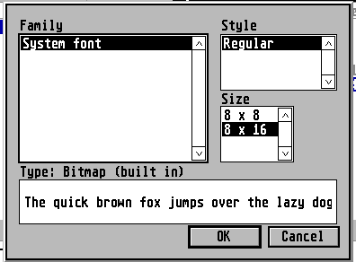
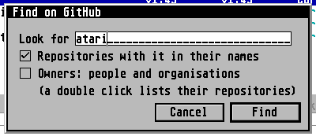
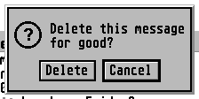
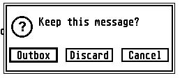
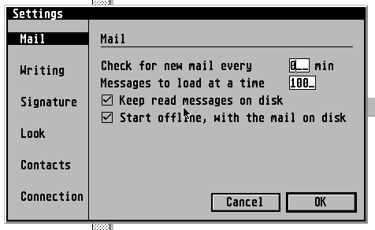
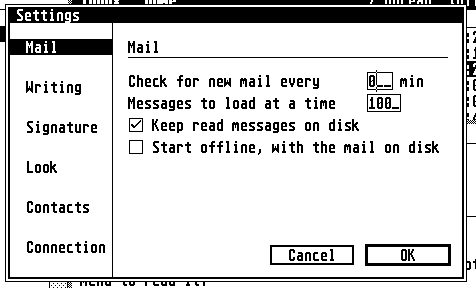
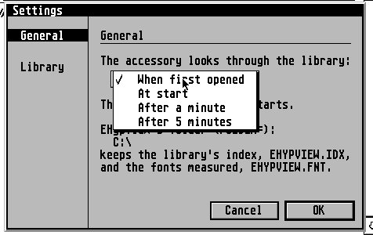

# Dialogs and controls

The exact specification behind guidelines 3.5, 5.4, 5.6 to 5.9, 6.1 to 6.3 and the new 5.10 "How a dialog is
run": how a dialog is built, drawn and run, what each control does with the keyboard and the mouse, how an
alert and a progress bar look. A developer reproducing a dialog without the apps in front of them should be
able to do it from this file and `common/ui`.

**Basis.** `common/ui/dialog.c`, `field.c`, `click.c`, `popup.c`, `progbar.c`, `alert.c`, `busy.c`, `clip.c`,
`clipedit.c`, `fontsel.c`, `filepick.c`, `langs.c`, `aboutbox.c` and `common/tests/dialog/test_dialog.c` in
AERA-Atari at 74253f3, and the apps' dialog code. **Nothing was run**: every claim is from source; where only
the AES decides, the text says "the AES's".

**Caveat.** The apps' dialog code was read from clones older than the release tags (EMail 1.67, EFTP 1.68,
EUpdate 1.21, EHypView 1.33, ECal 2.33, EContact 1.73, ClaudeST 1.68, EWeb 0.53; EPlay 1.10). Two facts were
checked again at the tags (EMail 2.14, EFTP 2.2, EUpdate 2.0, EWeb 0.81, EHypView 1.39, ECal 2.46, EContact
1.82, ClaudeST 2.1, EPDF 2.1, EPlay 1.10) and differ from the older reading: **EWeb and EPDF now call
`progbar_fill`** (5.9 below), and **ECal and EFTP build with `-DDLG_CLICK`** (5.8 below). Anything else here
that names an app is "as read in the older copy" until its session re-reads it; the apps' self-evaluation
against [DEVIATIONS.md](DEVIATIONS.md) is the check. EPDF has the Find dialog (`find.c`) besides Settings, which it is
rebuilding on the shared engine (unreleased); `Keys...` is added there.

**How to read it.** "The family does X" is the rule. Erez answered the open choices on 9 Nov 2026
([DECISIONS-2026-11-09.md](DECISIONS-2026-11-09.md)): a settled rule ends `Decided 9 Nov 2026 (Dn)`, and what the answers
left unsettled is under `Still open` at the end of this file. Ids `C1` to `C26` point to rows in
[DEVIATIONS.md](DEVIATIONS.md). F = focus app (EWeb, EPDF, EPlay), M = maintenance (the others).


---

## 1. How a dialog is run (new guidelines 5.10)

- **Built in code** from AES objects, no `.RSC`. The root is a `G_BOX`, `ob_spec` 0x00021100 (black 2-pixel
  frame inside, white), `OUTLINED`. Positions and sizes are in character cells of the system font (`cw` 8,
  `ch` 8 or 16 pixels); **the high byte of a coordinate is extra pixels** (`rsrc_obfix` makes `(v & 0xFF) *
  cell + (v >> 8)`), used for the half-line gaps between rows that hold framed fields. The builders are
  `d_begin / d_add / d_end` in EMail, EFTP and EUpdate (and EWeb; EHypView's `build`); EPlay and the shared
  dialogs fill a tree by hand. `d_end` is: `LASTOB`, `rsrc_obfix`, `dlg_3d`.
- **Opening.** `dlg_modal(tree, start, cancel)` centres, draws, runs and puts away. `dlg_open` ... `dlg_do` (or
  the app's loop) ... `dlg_close` where the dialog stays open while ticks and pages change (Settings). On TOS
  and EmuTOS: `wind_update(BEG_UPDATE)` and `(BEG_MCTRL)`, `form_center`, the root moved to the **nearest
  multiple of 16 pixels across** so its text starts on a byte (`align16`), the screen under it (and 4 pixels
  round it) saved in memory and put back at the end (`dlg_under`; no `WM_REDRAW` goes to the windows under it),
  `form_dial(FMD_START)` (no zooming boxes: `FMD_GROW` and `FMD_SHRINK` are never called), the mouse hidden
  while it is drawn. **The dialog is always centred; no app remembers a position.**
- **In a window** where the AES runs several programs (`dlg_windowed()`: `aes_count() != 1`, or MagiC):
  `dlg_open` makes a window with a name, closer and mover below the menu bar; the root's outline, shadow and
  frame are dropped (the AES's frame is the frame); **its own title band is hidden and what was below it moves
  up** when the app called `dlg_band(obj)`; the window's name is `dlg_name()`, else the band's text, else the
  app's name (`dlg_title`). The first click or key on a dialog that is not in front only brings it to the
  front; a click outside the dialog's window rings the bell. Alerts are the AES's own there (3.5).
- **Title: a black band in every dialog**, row 0, the full width, a `G_BOXTEXT` `te_color` 0x1071 (white on
  black), text left with one leading space (`" Settings"`). **In a window under a multitasking AES the window's own
  title replaces it:** `dlg_band(obj)` hides the band there and the window takes its text, so a dialog in a window
  has no band. (Alerts and the About box are not dialogs in this sense.) As built: EUpdate and EWeb put a band in
  every dialog, EFTP in four, EMail in one; EMail's and EFTP's small dialogs have a plain `G_STRING` at (2, 1) and
  no band; EPlay's and EHypView's asks have a line of text there; the Font and Languages dialogs have none; ECal's
  and EContact's have a black title bar with a centred bold title and a double frame; ClaudeST has a heading
  inside; EPDF's Find has a text line. All of those change. Decided 9 Nov 2026 (D22, C4).
- **Keys** (`dlg_do`; EMail's, EFTP's and EUpdate's private `form_loop` is the same except where 3.5 and 5.4
  say; C11):
  - **Return and Enter** pick the `DEFAULT` button (shown pressed, then returned). **Esc and Undo:** 3.5, below.
  - **Tab** and **Down** go to the next text field, **Up** to the previous (the AES's `form_keybd`; Shift+Tab
    is the AES's). Only text fields are visited, never buttons, ticks, radio buttons, pop-ups or the page
    names. **A tick, a radio button, a pop-up button and a Settings page cannot be reached from the keyboard**
    in EMail, EFTP, EUpdate, EWeb, EHypView or EPlay: there is no Space, no underlined letter, no accelerator
    (the Add files, Font and Languages dialogs have Up and Down in their lists). Fields on pages not shown are
    not `EDITABLE` (`show_page`).
  - ^C ^X ^V: 3 below. F10 switches the Hebrew keyboard in `dlg_do` loops (`heb_f10`) and in the private
    `form_loop` of EMail, EFTP and EUpdate (since 2.0; in EUpdate the band's badge changes at once, the window's at
    close).
  - Keys typed before the dialog opened do not answer it (`flush_keys`; `dlg_do` only; the private loops have no
    `flush_keys`).
  - The Help key is not taken by a dialog.
  **Keyboard reach is a rule, to build:** Space ticks a tick, the arrow keys move between radio buttons and in
  lists, and the Settings pages have keys. The focus apps first, the maintenance apps at a release they make
  anyway; the dialog loop and the Settings engine are hub work. How the keyboard focus reaches a tick, a radio, a
  pop-up button or a page name, and which keys change the page, is in `Still open`. Decided 9 Nov 2026 (D25, C6).
- **Mouse:** the left button only (mask 1, state 1). An exit button is pressed in while held and done when let
  go over it (the AES's `form_button`); a `TOUCHEXIT` object (a tick, a page name, a row, an arrow, a pop-up
  button) is done on the press; a click on a field moves the cursor into it (3 below); **a click outside the box
  rings the bell** (`Bconout(2, 7)`; the private loops ignore it silently); a `DISABLED` button does nothing
  (the AES's; the app's loop checks `DISABLED` for ticks). There is no right-button menu, no wheel and no drag
  in a dialog.
- **Closing:** the exit object comes back, with 0x8000 added for a double click on a `TOUCHEXIT`. The object is
  left `SELECTED` and the caller (or `dlg_modal`) deselects it. Settings stays open for ticks, pages and
  pop-ups and ends on OK or Cancel.
- **OK and validation.** OK is the `DEFAULT` button and keeps the dialog's values; Cancel keeps nothing.
  **A number out of range is refused with a short alert that says what to type; the dialog stays open and nothing
  is changed silently** (ECal's way: "Please type dates as|day.month.year: 12.10.2026", "Please type the server's
  address."; EContact refuses an empty server address the same way). EMail (messages at a time 20 to 1000, wrap
  column 40 to 78 else 72), EUpdate (hours 1 to 168), EWeb (text size outside 50 to 200 left as it was; a bad port
  to the default; the cache size cut to 512) and EPlay (a bad Gateway port set to 8580) put it right silently today
  and change. An empty line in an "ask" dialog is a Cancel (EMail, EUpdate). EHypView's "Look there anyway?" [Keep |
  Change] for a folder that isn't there is a question about a path, not a number (`Still open`). Decided 9 Nov 2026
  (D30, C21).
- **A dialog on a dialog** (a list over Settings, EMail's zone picker): the tree is kept aside and built in the
  same static tree; on TOS the dialog under it is drawn again when the list closes; in a window the AES asks
  for it.

---

## 2. Esc and Undo (guidelines 3.5, must)

The first paragraph and the "action is not done" list of 3.5 stay. The detail:
- **The keys.** Undo is scan code 0x61. Esc is scan code 0x01 or the character 0x1B. `dlg_cancel_key(key,
  in_field)` (`common/ui/dialog.c`): Undo always; Esc only when no text field has the cursor. The window's
  closer (under MiNT and MagiC) is Undo (`dlg_evnt_`: `WM_CLOSED` becomes key 0x6100).
- **Which button they pick:** Cancel, where there is one; otherwise the button that does nothing (Keep, Not now,
  Close); in a dialog that only informs (one OK), Esc closes it. **Esc never picks a button that acts**
  (Delete, Send, Overwrite, Quit), even when it is the default. So Cancel, or the button that does nothing, is
  always the last button of an alert (6.2); in a dialog box Cancel is left of OK (4).
- `dlg_do(tree, start, cancel)` and `dlg_modal(tree, start, cancel)` take the object to pick; **-1** means no
  button does nothing (EFTP's Skip | Resume | Replace): Esc and Undo then return -1 and the caller stops the
  operation. The private loops of EMail, EFTP and EUpdate (`form_loop`) find the button themselves: the `EXIT`
  button labelled "Cancel", else the only `EXIT` button; with several and no "Cancel", Esc and Undo do nothing
  (`esc_button`). ECal, EContact and ClaudeST take the button flagged `FF_CANCEL`.
- **In a text field Esc empties the field and the dialog stays open**, as `form_do` does: the field the cursor
  is in and no other, **also when it is already empty** (`lf_edit`, `objc_edit`). A dialog with a text field
  closes with Undo, Cancel or the closer. Settings has this twice over: on a page with a field Esc empties it,
  on a page without one Esc is Cancel.
  **There is no exception for a field that only filters a list:** Esc empties the filter, and on an empty one it does
  nothing more. The dialog closes only by its Cancel button or Undo. EPlay's Add files (`filepick.c`: `a == 27 &&
  !s_mask[0]`; fixed there on 9 Nov 2026, EPlay takes it with its sync) and EContact's choose mode (its toolbar's Cancel, or Undo, ends it) cancelled on an empty field
  and change. Decided 9 Nov 2026 (D28, C15).
- **A one-line text field of a window empties on Esc too** and nothing else happens (EHypView's library search,
  a list's filter). EWeb's address field puts back the page's address. **A text of several lines never empties
  on Esc**; only editing keys take text out there (ECal's and EContact's notes boxes, EMail's editor,
  ClaudeST's reply).
- **Also:** dialogs in a window or a pane (Find, Settings, a login form): Undo is Cancel, and Esc where no field
  has the cursor; with no Cancel (changes apply as made) Esc closes the dialog's window or goes back from the
  Settings pane, never the main window or the program. Pop-ups and context menus: Esc and Undo close them with
  nothing chosen. The About box: Return, Esc, Undo, Help, Space or a click closes it (`aboutbox.c`). A job that
  waits for the network: Esc or Undo stops it (7.1, `busy_idle`), as the Stop button does.
- **Alerts** (6.2): `alert()` gives the last button on Esc and Undo. On a multitasking AES (`dlg_windowed()`:
  MiNT with XaAES, N.AES, MyAES; MagiC) the alert is the AES's `form_alert`, wrapped as ours, and Esc does what
  that AES's alerts do (XaAES: nothing; Return, a click or the underlined letter answer). On TOS and EmuTOS Esc
  works because the box is ours. The crash alert stays on `form_alert` (6.4).
- **Reference:** `dlg_do`, `dlg_modal`, `dlg_cancel_key`, `dlg_undo`, `dlg_esc` (Esc or Undo, for lists and boxes
  without a field: Font, people, About). Tested in `common/tests/dialog` (`make test`; `run.py` on EmuTOS and
  `--xaaes`). The test uses a stand-in AES: Shift+Tab, Return with no default and a click on a disabled
  object are the real AES's and are checked on TOS 1.04, 4.04 and XaAES in the family run (C26).

---

## 3. Text fields (guidelines 5.4, must)

- **A field holds more than it shows** (Erez, 22 Oct 2026): it shows a window of its text and scrolls it with
  the cursor. Sizes: a GitHub token 99, a path as long as the app keeps it.
- **How much:** it shows at most `LF_VIEW` = 80 characters (its template, `_` for each); EMail's, EFTP's and
  EWeb's builders cut a field to 60. What it holds is the app's `cap`; a key into a full field is taken and
  ignored (no bell).
- **The cursor** enters a field **at the end of its text** (Tab, Up, Down, a click, or the dialog's start),
  `lf_enter`. When it goes back past the first shown character, a quarter of the field is kept to its left; at
  the end no empty room is left (`lf_view`).
- **The keys** (`lf_edit`, tested in `common/tests/dialog`):
  - characters 32 to 126 and 128 to 255 type at the cursor (the Hebrew keyboard maps them where the loop calls
    `key_char`, F10; 128 and up are the Atari character set); control characters and 127 are not the field's
    (Return, Tab and function keys go on to the dialog);
  - Backspace and Delete (nothing at the start or the end); Left and Right one place;
  - **Shift+Left, Shift+Right: to the start, to the end**; **ClrHome: to the start; Shift+ClrHome: to the end**
    (TOS gives the shifted arrows and ClrHome as '4', '6', '7', and TOS 1.04's AES sends them with Shift
    already up: the character counts as Shift);
  - **Esc empties the field** (2); Undo, Return, Tab, Up, Down are the dialog's (Tab and Down: next field; Up:
    previous);
  - **^C ^X ^V** (`clip_key`: the control characters 0x03, 0x18, 0x16, whatever the keyboard): **there is no
    selection in any field**, so ^C copies the whole text, ^X copies it and empties the field, ^V inserts the
    clipboard's **first line** (tabs as spaces, at most 255 bytes) at the cursor, one character at a time as
    typed (so a number field takes only digits and a full field stops the rest). In a field of several lines
    (ECal's and EContact's notes) ^C and ^X take the line the cursor is in;
  - a field of several lines is the app's own (ECal, EContact, EMail's editor, ClaudeST); Up and Down move
    between its lines, and between fields in a dialog only on the first or last line.
- **The mouse:** a click in a field moves the cursor **into** it, at the end of its text; a click in the field
  that has the cursor does nothing. There is no placing the cursor in the text, no selecting by dragging and no
  double-click selection in AES-based dialogs. ECal's and EContact's own fields (`ui/field.c:click_field`)
  put the cursor where the click was and show the focused field with a second line round it.
- **A password** shows one `*` per character (`lf_init(..., mask '*')`) and is never copied out: ^C and ^X do
  nothing, pasting works. The eye button after it (a 16 x 16 `G_IMAGE`, 1 cell after the field, `TOUCHEXIT`)
  shows or hides it. **While it is shown it must still not be copied** (`lf_mask` takes the mask away, so the
  app keeps its own flag: EFTP's `pw_of` does; EMail and EUpdate copy it, C12; ECal and EContact never copy an
  `FT_PASS`). A separate "secret" flag in `LFIELD` is hub work.
- **Hebrew.** AES-based fields keep the text in storage order and show it left to right, as GEM draws it; a
  Hebrew word is typed and shown in the order of the Atari character set. ECal's and EContact's own fields
  keep logical order and show it through the bidi code, with the cursor keys swapped in a right-to-left text
  (`edit_key`).
- **Reference:** `common/ui/field.c`: `lf_init()` on a `G_FTEXT` or `G_FBOXTEXT` whose template is as wide as it
  shows, `lf_enter`, `lf_key`, `lf_mask`; `dlg_do` and `dlg_modal` call them; a loop of the app's own calls
  `lf_enter()` and `lf_key()`. A field you only type digits into is a plain AES field (`te_pvalid` '9').
  Tested in `common/tests/dialog` (`test_dialog.c`).

---

## 4. The 3D look and the standard parts (guidelines 5.6, must)

- **Where the AES draws 3D objects, every dialog and alert has the 3D look.** That is AES 3.4 or newer
  (`aes_version() >= 0x0340`) and, where `appl_getinfo(13)` can be asked (AES 4, or the `?AGI` cookie), its
  answer says so (`dlg_3d_ok`): TOS 4, MagiC, N.AES, XaAES, EmuTOS's AES in 16 colours or more. TOS 1 to 3 and
  EmuTOS in fewer colours keep the flat look. There is no setting for it (27 Oct 2026).
- **What `dlg_3d(tree)` does to each object** (`common/ui/dialog.c`, after `rsrc_obfix`, before the first draw;
  `dlg_modal`, `alert()` and the Font dialog call it; an app's `d_end()` calls it):

  | Object | Flag | Look |
  |---|---|---|
  | `G_BUTTON` with `EXIT` or `TOUCHEXIT` | `FL3DACT` | raised (OK, Cancel, a choice that opens a list) |
  | `G_BUTTON` with `RBUTTON`, or `SELECTABLE` alone | `FL3DIND` | pressed in while `SELECTED` (radio buttons, a toggle) |
  | `G_BOXTEXT` or `G_BOX` **with a frame** and `EXIT`/`TOUCHEXIT`, `G_BOXCHAR` with them, not inside a white box | `FL3DACT` | raised (a pop-up button, a list's arrow) |
  | the root, `G_STRING`, `G_BOXTEXT` without a frame, `G_IMAGE`, `G_IBOX`, other boxes | `FL3DBAK` | on the 3D background (grey) |
  | `G_FTEXT`, `G_FBOXTEXT` | none | stay white |
  | a framed `G_BOX` that is hollow or white (`is_well`) and everything inside it | none | stays white (a list, a text area) |

  **A list's rows must be children of its white box** (EFTP's `d_nest`); rows beside the box are painted on the
  grey, and a `SELECTED` row of that kind is the grey inverted (dark green in EmuTOS's 256 colours; EMail's
  `pick_w` has this to check, C10).
- **Flat** (TOS 1 to 3, as TOS 1.04 draws it; `cpu_object`, `K_BUTTON`): the root is white with a 2-pixel black
  frame inside it and a 3-pixel outline (2 white, 1 black) outside; a `G_BUTTON` has a 1-pixel frame
  **outside** it, 2 with `EXIT`, 3 with `EXIT` and `DEFAULT`, its word centred; `SELECTED` is the box turned
  over; `DISABLED` is the dithered grey. A framed field (`te_thickness -1`) has its line 1 pixel outside the box.
- **A choice is never marked by `SELECTED` on a background object** (a page in Settings): in 3D the AES
  inverts the grey. Mark it with a black bar, as the title band is drawn (`te_color` 0x1071 for the chosen one,
  0x1180 for the others), or with a radio button.
- **The tick box** is not an AES object (`d_tick` in EMail, EFTP, EUpdate, EWeb): a 16 x 16 `G_IMAGE` (8 rows
  tall on an 8-pixel font), 2 cells wide, `TOUCHEXIT`, drawn in pen 1 (a frame, and a tick inside when on), and
  its words a `G_STRING` 3 cells to the right, also `TOUCHEXIT`. A click on either toggles it **on the press**;
  the box alone is drawn again (`dlg_draw`) and the loop waits 120 ms (`evnt_timer_(120)`). A tick has no
  keyboard way in and no disabled look; a disabled one ignores the click (its `DISABLED` state is tested in the
  loop).
  **A bitmap tick for every on/off setting, radio buttons for one of several** (rule as written; apps change at a
  release they make anyway). ECal's and EContact's own tick (`draw_field`, `FT_CHECK`) is a white box `2*cw - 4` wide,
  `ch - 2` high, with a 2-pixel-thick tick; EMail's account dialog has one toggle drawn as a `G_BUTTON` ("leave mail
  on the server", `d_check` becomes `d_tick`); EUpdate uses ticks as a group of exclusive choices (`group_of`
  becomes radio buttons, or a pop-up above four). Decided 9 Nov 2026 (D23, C5).
- **Radio buttons** are `G_BUTTON`, `SELECTABLE | RBUTTON`, 8 or 9 cells wide, 10 apart (EMail's IMAP | POP3,
  EFTP's By type | As text | Binary, EPlay's Auto | FDI | DSP, ClaudeST's `own_add(... RBUTTON)`); the AES
  unselects the others of the same parent. **They are for one of up to four choices; above four, a pop-up button
  (5.7).** An existing pop-up of four choices or fewer (ECal's) becomes radio buttons. A choice that does not apply
  is greyed (EPlay greys FDI and DSP on a machine without them): the shared Settings engine's `set_tick_group` and
  `set_popup` cannot grey one choice yet, and learn to (hub work). Decided 9 Nov 2026 (D24).
- **Exit buttons one under another get room between them** (half a line) when 3D is on, because raised buttons
  grow by a few pixels.
- **Dialogs an app draws itself** (ECal's and EContact's `ui/field.c`, ClaudeST's `own_*`) take the AES's 3D look
  through `dlg_look3d()` = `dlg_3d_ok() && ncolors >= 16`: the ground `LWHITE` (pen 8), their buttons the AES's
  own (`aes_button`), pop-up buttons raised by `bevel()`, fields, ticks and lists white. Their rows are `ch + 6`
  high, the focused field has a double line and the pop-up button is flat with a shadow: they are the "older"
  dialogs to bring over (C24).
- **Buttons are the AES's:** an exit button in a dialog is a `G_BUTTON` drawn by the AES, never by hand. (A
  toolbar's hand-drawn buttons are accepted when they behave right: [WINDOWS.md](WINDOWS.md) 3, D33.) Anything the app
  draws into a dialog clears its place by drawing the tree there (`objc_draw`), never with white.
- **The pop-up menu itself is flat in every look:** `popup()` draws a white box with a 1-pixel frame and a
  2-pixel black shadow with the app's own primitives (`popup.c`).

---

## 5. Pop-up buttons, frames and edges (guidelines 5.7, must)

<!-- SCREEN: file-selector (Add files, common/ui/filepick.c: not captured yet) -->




- **A button with a down arrow opens a pop-up menu there and then:** the shared `popup()` (3.3), the choice it
  shows ticked, a click on another choice changes it at once.
  - **How the button is drawn:** a `G_BOXTEXT`, `TOUCHEXIT`, `te_thickness = -1`, `te_color` 0x1180, text
    left-justified: a space, the choice padded to the width, and the system font's down arrow `\x02` in the last
    cell: `sprintf(label, " %-21s\x02", choice)` for a button 23 cells wide (EHypView `start_show`); EFTP's
    `choice_label` makes the same for 28 cells, with the right-hand note (an offset) before the arrow. It is
    never a plain `G_BUTTON` and never a drop-down the app draws (EPlay's Add files drew plain `G_BUTTON`s
    centred, `"%s \x02"`: C9, fixed in `filepick.c` on 9 Nov 2026). In 3D it is raised; flat it is a framed box.
  - **The menu's items** start with two spaces; the ticked one starts with `\x08` (the Atari check mark) in
    place of the first space: `"%c %s"` with `'\x08'` or `' '`. `popup()` puts the check mark half a cell in
    and every item's words 2 cells in from the left edge. The shared `popup_m()` adds the margin itself
    ([MENUS.md](MENUS.md) 3.1, D15; hub done, apps move as they sync): an item is just its words, the ticked
    one `\x08` and its words. The shared Settings (`set_popup`) and file dialog already use it.
  - It sits in the settings' value column (`SX + 30`) or after its label; the dialog under the menu is drawn
    again when `popup_put_back` is 0. `popup()` itself moves a menu left to fit the desktop, and above the point
    when there is no room below.
  - **Where it opens: the ticked row over the button,** the AES's own pop-ups' way. EHypView does it today
    (`over_button`: `y - 3 - sel * (ch + 2)`, rows `ch + 2` high from 2 pixels down). EFTP (`exists_pick`,
    `proto_pick`) and EContact (`popup_over`) put the menu's top-left at the button's top-left whatever is ticked;
    ECal does the same, but through `field.c` `dlg_run` (`FT_POPUP`) into `popup.c` `popup()`, not `popup_over`
    (corrected 9 Nov); EMail's Translate pop-up and EPlay's Add files (`below()`, hub) open below the button. They
    change, and the shared `popup()` gets an "over this button" call (hub work). Decided 9 Nov 2026 (D27, C8).
- **A choice from a long list is not a pop-up:** the button shows the choice and ends in "...", with no arrow,
  and opens a dialog with the list (EMail's and EFTP's time zones, `zone_label`: 28 cells, "..." in the last
  three). An arrow that opens a dialog promises what it doesn't do.
- **Every text field you type into has a frame:** one line, 1 pixel outside the object (a `G_FBOXTEXT`,
  `te_thickness -1`, white, `te_color` 0x1180), flat or 3D, so rows that hold fields are a few pixels further
  apart than a text line. A list or a text area is a white `G_BOX` with a frame (0x00FF1100). No field without a
  frame beside one with it.
- **Panes meet with one line; a splitter is not a gap:** unchanged (see [WINDOWS.md](WINDOWS.md), panes).
- **Pop-up menu** (`popup.c`): rows `ch + 2` high (`ch` on a desktop too short), 2 pixels of margin above the
  first; a separator ('-') a row high (4 pixels on a short desktop); disabled items ('~') dimmed; the item
  under the pointer is a black bar with inverse text; width = longest label + 4 cells. Keys: Up and Down
  (wrapping, skipping separators and disabled items), Return or Space picks the lit item, Esc or Undo closes.
  Press-drag-release from the opening click picks the item the pointer is on when it is let go, if it moved
  more than 3 pixels; otherwise the first release only opens it; a later click picks the item under it, or
  closes it on a click outside.

---

## 6. Clicks in dialogs (guidelines 5.8)

- **Window event loops ask `evnt_multi` for one click** (`evnt_multi(..., 1, ...)`) and time the double click
  themselves. **Dialog loops ask for two** by default (`DLG_CLICKS` is 2 unless `-DDLG_CLICK`; EMail's, EFTP's
  and EUpdate's `form_loop` pass 2), as GEM's `form_do` does, so a press on a tick, a page name or a list row in
  a dialog is handed over after the double-click time. `-DDLG_CLICK` with `click.c` asks for one (`dlg_touch`,
  `dlg_touch_up`). **ECal and EFTP build with `-DDLG_CLICK`** (their Makefiles at the release tags); EWeb,
  EPDF, EPlay, EMail (which links `click.o` since 2.13), EHypView and EUpdate do not; EContact's own dialogs already
  ask one click, only its Font dialog is affected (corrected 9 Nov). **Every app builds `-DDLG_CLICK`:** that is the
  dialog loop, apart from the window list's `click.c` that EMail and EUpdate adopt (W24); the focus apps now, the
  others at a release they make anyway (C16). Only Add files (`filepick.c`), the
  Languages dialog, the About box and (unless a button is held) the Font dialog ask for one.
- **As built in dialogs:**
  - the AES's own exit buttons (`dlg_do`, `form_button`): pressed in while held, done when let go over them,
    nothing when let go elsewhere. ECal's, EContact's and ClaudeST's own dialogs **act on the press** (ECal and
    EContact flash the button for 90 ms, `press_effect`; ClaudeST not at all); the Font dialog acts on the
    release **wherever the pointer is** (`on_click`: `left_up()`). The rule is 5.8's: **a button acts when the mouse
    is let go over it**, shown pressed meanwhile (C7; ECal, EContact, ClaudeST at their next release, the Font dialog
    in `common/`); the one exception is **Stop in a job, which acts on the press** (D32);
  - a list row in a dialog is a `TOUCHEXIT` object: it is chosen **on the press**, a double click (the AES's
    count, bit 0x8000 of the result) takes it, and nothing waits for the release (EMail's and EFTP's `pick_w`;
    EPlay's Open URL rows are not `TOUCHEXIT`: they are `SELECTABLE | EXIT` `G_STRING`s on the root that act on the
    release, with no white well: corrected 9 Nov);
  - ticks and the Settings page names (`TOUCHEXIT`) act on the press as well. **Menus, pop-ups, ticks, pop-up
    buttons, page names and list rows act on the press; buttons act on the release over them.** This is the
    reading of 5.8 that fits the code; ECal's and EContact's ticks and pop-ups on the press (C7) follow it, which
    Erez has not said in so many words (`Still open`).

---

## 7. The progress bar (guidelines 5.9, must)

- **The colour rules are exactly `progbar_pens`:** 256 colours blue (strongest component blue, at least
  250/1000 above the weaker of red and green, hue 195 to 250 degrees, and not within 3000 of the ground in
  colour), up to `PB_SHADES` = 16; 16 colours pens 1 to 15 in order less the ground's pen; every other screen
  one black pen (pen 1 unless another is darker).
- **Geometry is the app's.** `progbar_fill(h, x, y, w, hh, from, to)` fills the part `from` to `to` (0 to
  `PB_FULL` = 1024) of a box the app chooses and draws the ground beyond it; `progbar_pens(h, ground)` finds the
  pens (once, and again when pens 16 and up change). Each pen takes an equal share of the width (`w * i /
  npen`), so with 16 colours the bar has 15 parts or fewer, and filling reveals them. With no blue entry in
  256 colours it takes the nearest pen of any.
- **Who uses it** (at the release tags): EWeb (`ui/win.c`: a 3-pixel strip, 2 on an 8-pixel font, along the
  foot of its status bar), EPDF (`src/gem/textwin.c`, `epdf.c`) and EConvert (`econvert.c`, two bars) call
  `progbar_fill`. Own bars remain in EFTP (a bar a row in the Transfers pane, its own colours), EContact (its
  progress box fills with `sel_color()`) and EWeb's quit box (a plain black `G_BOX`); they move to `progbar`
  when each next draws progress (C22). EPlay and the maintenance apps: section 8 of the guidelines.
  **EFTP keeps a bar per running row** (the Transfers pane is a list of items), drawn with `progbar_fill`, so its
  colours become the shared ones (the direction arrow keeps its colour); **EConvert keeps its two bars** (the file's
  and the batch's). Both are written exceptions to 5.9's one bar for the whole job. Decided 9 Nov 2026 (D48,
  D34).
- **Where:** at the foot of the status bar of a window (EWeb, EPDF), or in the progress box of a job that has
  no window (6.3). Tested: `common/tests/progbar` (`make test`; `run.py WORK MACHINE [--nvdi]`).

---

## 8. Alerts (guidelines 6.2) and progress (6.3)





- **One shared `alert(def, fmt, ...)`** (`common/ui/alert.c`, from ECal's). It formats like `printf`, wraps the
  text at **30 characters** (a line breaks at the last space that leaves it 30 characters or fewer; a word
  longer than 30 is cut; a `|` starts a line), keeps **5 lines at most (a sixth is dropped without a word)**,
  puts Hebrew into display order (bidi) and changes `[` and `]` in the text to `(` and `)`.
- **The string** is form_alert's: `"[icon][line|line][But|But]"`. At most **3 buttons**; the code takes labels of
  up to 20 characters (`AL_BUT`); **the house rule is about 10** (12 are in use: "Open in EWeb"). An icon that
  is not a digit, more than 3 buttons or a label over 20 sends the string to the AES's `form_alert` unchanged.
- **Icons:** 1 (!) to inform, 2 (?) to ask, 3 (stop) when something failed; 32 x 32, drawn in the box's top
  left. A stop alert has one button, "OK" (in the crash path `form_alert` with "Quit", 6.4).
- **Layout** (`al_build`, in cells of the system font): 1 cell margin; the icon at (1, 1) takes `ceil(32 / cw)`
  cells (4) and the text starts 2 cells after it; the lines from row 1; one empty row; the buttons; one empty
  row. Every button is the width of the longest label **plus 1 cell**, the labels centred, **2 cells apart**,
  the row centred on the box; `G_BUTTON`, `SELECTABLE | EXIT`. A single "OK" is written `" OK "` (spaces inside
  the brackets) so that its button is not narrow (277 uses). The box is the same `G_BOX` as a dialog's
  (0x00021100, `OUTLINED`), centred like one, 3D by `dlg_3d`, the mouse an arrow. Only a lone OK is padded; the
  hub may pad inside `alert()` instead (C19). Not every
  padded form in the old list exists: EFTP pads only a lone OK, and neither EFTP nor EWeb has a padded `Replace |
  Cancel` (EPlay's failure alerts do); EWeb's `confirm()` (` OK |Cancel`) and EHypView's ` Keep |Change` are padded
  oddly (corrected 9 Nov).
- **Text:** what happened, then what to do, a line each: "Can't reach the server.|Check the network and try
  again." Questions end in "?"; a second line in brackets says what stays ("(Its mail stays on the server.)");
  statements end in a full stop. The apps break lines by hand at 30 or fewer; `alert()` wraps what is left.
  Error numbers go at the end in brackets, if at all.
- **Buttons are verbs, action first, Cancel last, and the first button repeats the question's verb:** "Delete
  the folder ...?" [Delete | Cancel], Quit, Import, Forget, Download, Replace, Discard, Empty, Clear. Three
  choices: [Only this | All future | Cancel], [Save | Skip | Stop]. **In an alert Cancel is the rightmost
  button; in a dialog box it is the left one of two** (C20).
- **Default (`def`, 1 to 3; 0 none):** Return picks it. The safe button: **Cancel (2) for a destructive
  question** (Delete, Quit, Discard, Forget, Replace), the first for the others ([Open | Later], [Check |
  Later], [Download | Cancel], [Locate... | Use C:\ECAL | Cancel], [Only this | All future | Cancel]). An
  information alert has "OK" and def 1.
  **EFTP's "Already there" defaults to Skip.** It defaulted to Replace, the action that overwrites; it has no
  Cancel, and Esc stops the transfer. Decided 9 Nov 2026 (D29, C17).
- **Esc and Undo pick the last button** (3.5). A click on a button acts on the release (`form_button`). On a
  multitasking AES (MiNT, MagiC) it is the AES's `form_alert` with the same wrapped text.
- **Progress and status** (6.3): every wait is signalled in three places and ended by Esc: the **busy bee**
  (`busy_bee(1)`; `graf_mouse(BUSYBEE)`) from the moment the program stops answering for more than a moment;
  the window's **info line** says what is being done and, where it fits, how far and how to stop it; **Esc and
  Undo stop it** (`busy_idle` sets `conn_stop`; every other key is kept for after), the operation ends as a
  timeout would and what was done is said. Long work shows its progress in the window with a **Stop** button;
  a modal progress box only when there is no window to show it in (EWeb's quit box, " Closing EWeb": a line
  of words, a bar, no buttons). EContact's Sync Contact Photos opens a modal box (46 cells wide, two lines of
  text, a bar, a 10-wide Cancel at the right (it reads Stop: D31); Esc, Undo or the button say "Stopping..."): an exception to
  leave until it is next touched (C23). **`Stop` is the word for a job and `Cancel` only for a dialog** (EContact's
  box changes). Decided 9 Nov 2026 (D31). Playback is not a job: Undo stops a load or a connection, and the Stop key
  stops playback (D54). The job windows' look is in [WINDOWS.md](WINDOWS.md).

---

## 9. The Settings dialog, corrected (guidelines 6.1)






The text of 6.1 stays, with two corrections taken from the code:
- **The chosen page is a black bar:** its `te_color` is 0x1071, the others' 0x1180; **never `SELECTED`** (5.6).
  Each page name is a `G_BOXTEXT`, `TOUCHEXIT`, text `"  Name"`.
- **Button positions:** Cancel at `W - 24`, OK at `W - 12` is true of EMail, EFTP, EUpdate and EHypView (EMail:
  `SX + 18` and `SX + 30`). **EWeb has `SX + PW - 26` and `SX + PW - 13`** and a list `SW` of 12, not 13: a
  deviation to correct in EWeb, not a second form (C3).
- **OK and Cancel order:** Cancel then OK, OK on the right. The Font dialog (`fontsel.c`), the Languages dialog
  (`langs.c`) and EPlay's Settings put OK first; those are deviations to fix, not an alternative (C1).
- **Decided 9 Nov 2026:** a choice of up to four is radio buttons and of more a pop-up button (D24; the engine learns to
  grey one choice); a number out of its limits is refused with an alert (D30); the controls and the pages get keys
  (D25); the pop-up opens over its button (D27).

---

## 10. Dialog anatomy, as built

Sizes are in cells of the system font (`cw` = 8 px; `ch` = 8 px on ST low and medium, 16 px on ST high, TT and
Falcon modes of 400 lines or more). `+n` is the high-byte pixels. `W` and `H` are the root's cells. The root
sits in a 3-pixel outline outside it (white 2, black 1; flat only); the 2-pixel black frame inside means
**content starts 2 cells in from the edge** (x = 2), not 0.

### Common parts
| Part | Object | Numbers | Where |
|---|---|---|---|
| Root | `G_BOX` 0x00021100, `OUTLINED` | W x H; 3D flag on the root on TOS 4 | `d_begin`; `dlg_3d` |
| Title band | `G_BOXTEXT` `te_color` 0x1071, `te_just` 0, `te_font` 3 | (0, 0), W x 1; text " Title" | `d_band` |
| Plain title | `G_STRING` | (2, 1), len x 1 | EMail `dlg_ask`, `dlg_keys` (goes: D22) |
| Label | `G_STRING` | x = 2 (or `SX`), 1 high | `d_text` |
| Field | `G_FBOXTEXT` `EDITABLE`, `te_color` 0x1180, `te_thickness -1`, `te_font` 3, template `_` x n, valid `X` or `9` | n x 1, frame 1 px outside | `d_framed`, `d_edit` |
| Button | `G_BUTTON`, `SELECTABLE \| EXIT` (+`DEFAULT` on OK) | 10 x 1 | `d_button` |
| Radio | `G_BUTTON`, `SELECTABLE \| RBUTTON` | 8 or 9 x 1, 10 apart; up to four to a group | EMail `dlg_account` |
| Tick | `G_IMAGE` 16 x 16 + `G_STRING`, both `TOUCHEXIT` | box 2 x 1 at x; words at x + 3 | `d_tick` |
| Pop-up button | `G_BOXTEXT` `TOUCHEXIT`, `te_thickness -1`, `te_color` 0x1180 | 23 to 28 x 1; text " %-Ns\x02" | section 5 |
| List well | `G_BOX` 0x00FF1100 (frame outside, hollow) with the rows as its children | n x 12 for a pick list | `pick_w` |
| List arrow | `G_BOXCHAR` 0x01FF1100 (up, char 1) / 0x02FF1100 (down, char 2), `TOUCHEXIT` | 2 x 1, right of the well | `pick_w` |
| Rule | `G_BOX` 0x00001171 | 0 cells + 1 px thick | Settings |
| Eye | `G_IMAGE` 16 x 16, `TOUCHEXIT` | 2 x 1 at field x + len + 1 | `d_long` |

**Row pitch.** Plain text rows are 1 cell. A row with a framed field gets extra pixels so frames do not touch:
Settings `ROW(n) = (y0 + n) | ((2 + n * row_gap) << 8)` with `row_gap = ch * 3 / 8` (6 px with a 16-pixel font,
3 with 8); EMail's account dialog adds `a_gap` (3 px, 2 on an 8-pixel font) per row from row 4 (`AYP`); the page
names have `ch / 2` more per step. Exit buttons one under another: half a line between (3D).

### Button row and margins
- **Two buttons:** Cancel at `W - 24`, OK at `W - 12`, both 10 wide: right margin 2, gap 2. Row `H - 2`, one
  empty row under it (EMail, EFTP, EUpdate, EHypView, ECal, EContact; ClaudeST `cancel_x = ok_x - btn_w - 2*cw`,
  `ok_x = x + w - 2*cw - btn_w`).
- **One button** (Keys, info): OK at `W - 12`, row `H - 2`. **Three** (EFTP "Already there"): Skip (default) |
  Resume | Replace, 10 wide (12 today, at x 2, 16, 30).
- **Variants in use (deviations, C1 to C3):** EPlay 9 wide, OK left at 40, Cancel at 51 in 62 (the reverse of
  the rule); Font dialog 9 wide, OK at 26, Cancel at 37 in 48; Languages the same on row 16; Add files 8 wide,
  Cancel at 24, Add at 33 in 42; EWeb 10 wide with gap 3 and margin 3; pick list OK at `lw - 6`, Cancel at
  `lw - 18`, margin 4.
  **Buttons are 10 wide, wider only if the label needs it.** EPlay and the Font and Languages dialogs (9), Add files
  (8) and EFTP's "Already there" (12) change; the Font, Languages and Add files dialogs are hub work. An alert's
  buttons keep their own rule (6.2: the longest label plus a cell). Decided 9 Nov 2026 (D26, C2).

### The standard dialogs
**A question with a line to type** (EMail `dlg_ask`; EFTP, EUpdate, EWeb, EHypView the same, plus or minus a row):
`W = max(40, len + 6)`, `H = 8` (EUpdate: band at row 0, label row 2, field row 4, buttons row 6; EWeb: `W` 44,
`H` 9, three text rows 2 to 4, field 5, buttons 7 at 18 and 31).

```
row 0   |                                              |   (EUpdate, EWeb: black band " Title" here)
row 1   |  Title                                       |   (EMail, EFTP: plain G_STRING at x=2)
row 2   |                                              |
row 3   |  Label                                       |
row 4   |  [__________________________________]       |   framed field at x=2, len cells
row 5   |                                              |
row 6   |                       [ Cancel ]  [  OK  ]   |   Cancel W-24, OK W-12, 10 wide
row 7   |                                              |
```

**A pick list** (EMail/EFTP `pick_w`): `W = lw + 8`, `H = 12 + 8 = 20`; title (2, 1); well (2, 3) `lw` x 12 with
12 `G_STRING` rows (each 1 cell, one space in); arrows at (`lw + 3`, 3) and (`lw + 3`, 14), 2 x 1; count line
"1-12 of 400" at (2, 16); buttons row 18. Up and Down page by 12; OK `DISABLED` until a row is chosen; a double
click takes the row.

**Info** (Keys): `W` 52 to 56, `H = n + 6`; title (2, 1); the n lines at x = 3 from row 3; OK at (`W - 12`, `n + 4`).

**Settings** (6.1; built in `settings_sidebar`): `W = SX + 42` (57), `H` 16 or 17; band row 0; the list `SW` = 13
wide with a 1-pixel line at column 13 from row 1, page names at x = 2 px, row 2 + 2k (+ k * `ch / 2` px),
`SW - 1` cells + 6 px wide; page heading at (`SX` = 15, 2); rule at (`SX`, 3 + 2 px) 40 wide; settings from row
4, values at `SX + 30`; buttons `W - 24`, `W - 12` at row `H - 2`.

**Alert** (`al_build`): 1-cell margin; icon (1, 1); text at x = `ceil(32/cw) + 2` = 6, rows 1 to n; buttons row
`max(icon rows + 1, n + 1) + 1`; `H` = that + 2; buttons `longest + 1` wide, 2 apart, centred.

**Progress box** (EContact `prog_open`): `W` 46, `H` 5 of rows `ch + 6`; line 1 at row 2, bar at row 3, line 2 at
row 4 with a 10-wide Cancel at its right (x = `W - 10`).

**Fonts.** Everything in an AES dialog is the system font (`te_font` 3, IBM; `G_STRING` and `G_BUTTON` take the
AES's), 8 x 8 or 8 x 16. Text goes on multiples of 8 pixels across (`align16`; the 16-pixel rule).

---

## 11. Not in the code (so not in the standard)

- Underlined-letter or accelerator keys in dialogs; Space on a tick; Tab to a button; keys that change the
  Settings page (the last two kinds are decided and to be built: D25); the Help key in a dialog.
- Mouse selection in a text field, drag, double-click word selection, a right-button menu in a dialog, the wheel.
- A remembered dialog position; zooming boxes.
- Any number for a tick label's wrap, or a maximum dialog height (EMail builds its account dialog 62 x 24 or 25;
  the desktop is the limit).
- What `form_keybd` does with Return when there is no `DEFAULT`, and with Shift+Tab: the AES's.
- Whether the pop-up's choice in `popup()` is made on the press or the release of a later click: it is the
  `evnt_multi` button event with state 0 (the AES's definition).

---

## 12. Still open

The answers of 9 Nov did not settle these; nothing here is guessed.

- **How the keyboard reaches a control** (D25). The rule says Space ticks a tick, arrows move between radio buttons
  and in lists, and the Settings pages have keys. It does not say how the focus gets to a tick, a radio, a pop-up
  button or a page name (today Tab visits text fields only), whether it shows a ring, or which keys change the page.
  The hub designs it with the focus apps and brings it to Erez as a UX decision.
- **A radio group in the Settings page** (D24). Four radio buttons are 40 cells wide (10 apart) against the 30-cell
  value column and the 42-cell page: how the engine lays a group out is the hub's to propose.
- **The words of the out-of-range alerts** (D30). ECal's are the model; each app proposes its own, and the words are
  Erez's to approve.
- **EHypView's "Look there anyway?"** (C21) is about a folder that isn't there, not a number; D30 does not cover it.
- **Press and release for ticks and pop-ups** (contradiction 2 of the evaluation). 5.8's "act on release" is written
  here for buttons, with menus, pop-ups, ticks, pop-up buttons, page names and list rows on the press, which is what
  the code does. C7 asked ECal and EContact to move ticks and pop-ups to the release; read this way it does not.
  Erez's answers (D32, D33) speak of buttons only, so he may want to say.
