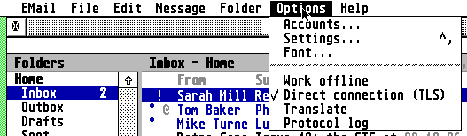
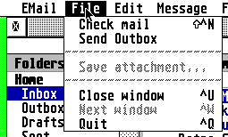
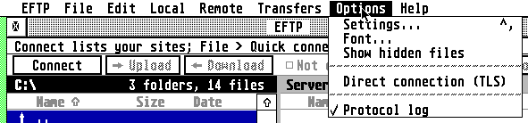
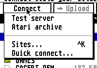
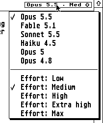

# Menus, shortcuts, context menus and tooltips

This is the exact specification behind guidelines 3.1 to 3.4. It is written from the code of every app at
its latest release tag (9 Nov 2026) and of `common/` in AERA-Atari at 74253f3, so that a developer can
reproduce the family's menus without seeing the apps. Where this file and the guidelines' short text differ,
this file is the detail and the guidelines link here.

**Basis.** EMail 2.14, EFTP 2.2, EUpdate 2.02 (corrected 9 Nov), EWeb 0.81, EHypView 1.39, ECal 2.46, EContact 1.82,
ClaudeST 2.1, EPDF 2.1 (with EConvert), EPlay 1.10. Every app's copy of `common/ui/mbar.c`, `mbar.h`,
`popup.c` and `popup.h` is byte-identical to the hub's. A pointer reads `app: file:function`, from the app's
repository root at that tag.

**How to read it.** "The family does X" is the rule. Erez answered the open choices of
[EVALUATION-2026-11-09.md](EVALUATION-2026-11-09.md) on 9 Nov 2026 ([DECISIONS-2026-11-09.md](DECISIONS-2026-11-09.md)):
a settled rule ends `Decided 9 Nov 2026 (Dn)`, and what the answers left unsettled is under `Still open` at the end of
this file. Where an app does not meet a rule yet, its row in [DEVIATIONS.md](DEVIATIONS.md) says so (ids such as `MD7`
point to it): a focus app (F: EWeb, EPDF, EPlay) takes it as work, a maintenance app (M: all others) with a release it
makes anyway.

---

## 1. The menu bar (guidelines 3.1)

### 1.1 Titles and the builder
- **Titles, in this order, leaving out those with nothing in them:**
  **Desk · File · Edit · View · [the app's own] · Options · Help.** All ten apps follow this. The app's own
  titles come after View: EMail Message and Folder; EFTP Local, Remote and Transfers; EUpdate Repository;
  EWeb Bookmarks; EHypView Navigate and Bookmarks; ECal Event; EContact Contact; ClaudeST Chat; EPDF Page;
  EPlay Play. A title with nothing to hold is left out (EContact has no Edit; EPDF has no Options until it moves Settings and Font
  there: MD1, D6).
  A title's text is `" File "`: a space each side.
- **The Desk title is the product name, `" EMail "`, never the word "Desk"** (1.1). Its menu is
  `About NAME...` and nothing else of the app's. The builder adds a line and six slots that the AES fills
  with the accessories' names, and makes this menu at least 22 characters wide (`common/ui/mbar.c`:
  `mbar_build`, `ACC_SLOTS`, `menu_width`).
- **The bar is built at run time by `mbar_build()` from a static table**, no resource file: `MBAR_TITLE
  { title, items }` and `MBAR_ITEM { text, key, cmd }`, ending in a 0 entry. The app finds an item with
  `mbar_object(&mb, cmd)` (for `menu_ienable` and `menu_icheck`) and the chosen one with
  `mbar_command(&mb, msg[4])` when `MN_SELECTED` arrives. After the command it **always** sets the title
  normal again with `menu_tnormal(mb.tree, msg[3], 1)`. `common/tests/menu/test_mbar.c` checks the tree.
  EWeb and EHypView build the bar again when their bookmarks change (`menu_bar(old, 0)`, then
  `menu_bar(new, 1)`).
- **An item is laid out as `"  Text   Key "`** (`mbar.c:item_text`): two spaces first (the AES draws the
  tick over the first), the shortcut flush right with one space after it, and at least three spaces between
  the longest text and its shortcut. A line is the item `{ "-" }`: the builder draws a row of dashes and
  disables it. A drop-down is as wide as its longest item.

### 1.2 Shortcut text
- The `key` string is `^N` for Control+N. **Shift is the byte `\x01` in front**: `"\x01^F"` shows ⇧^F (the
  system font's shift arrow, the glyph of the up arrow).
- Named keys are written `Help`, `Undo`, `Del`, `Esc`, `F10`, `^Left`, `^Right`, `^Home`, `^Return`,
  `\x01Return`, `\x01Undo`. A key without Control is shown bare (`D`, `Space`, `ClrHome`, `Return`): those bare names are
  right as they are. A shifted arrow is the shift byte and the arrow (EPlay's `⇧←`, `⇧→`). Write `Del`, never `Delete`
  (MD14; EPlay's Edit menu to be corrected).
- **An item shows a key only if that key does that command.** The menu table and the key switch are written
  by hand in each app (`shortcut()` or `win_key()`), so they are changed together. A key that is only an alias
  is not shown (EMail's `^K` and `^E`).

### 1.3 Ticks, greying and the keys behind them
- **A tick shows a state and is never the state itself.** Each app has one `menu_update()` that copies its
  settings into the bar (`menu_icheck(tree, obj, on)`; the AES draws the mark in the first column) and the
  greyed state (`menu_ienable`), and calls it after every command, key, click and message. A tick in Options
  and the same setting's tick in Settings are therefore one variable (`opt.falcon`, `opt.offline`,
  `opt.log`): the menu command flips it, Settings sets it, the next `menu_update()` shows it.
- **`menu_update()` asks the AES only for what changed**, by remembering the last state (`was[]`,
  `menu_was`, or the item's `ob_state`): every call is an AES call, and EMail measured 40 calls at 40 ms on
  an 8 MHz ST. EContact's `enable()` and `check()` ask every time, 8 calls after each key, click and message
  (MD23).
- Ticks are for settings that change at once and for the view or mode shown (Day/Week/Month/Year, Calendar
  list, Server messages, Pages, Shuffle). A group of exclusive choices is several ticks of which one is set
  (ECal's views, ClaudeST's baud rates, EPlay's connection). `Direct connection` also loads
  `TLS.OVL`; if that fails the app alerts and leaves the tick off (`falcon_mode_set` returns 0).
- **A command that cannot apply now is greyed in the menu, and its key does nothing** (the key code checks the
  same condition: EMail `ui/main.c:shortcut`). The bar never hides an item. Reasons that grey: nothing
  selected, the wrong focus (Cut and Paste), no document, a job running (EUpdate; EFTP follows: D19), offline, POP or local
  folders (EMail), a limit reached (EWeb zoom). ClaudeST and EPlay grey nothing today.
- **While a job runs, the commands that would start another are greyed and their keys do nothing;** Stop stays
  live (EWeb). EUpdate does this: it disables the commands and `ui/main.c:idle` reads and drops every other key and
  menu choice. EFTP greys no menu item today: it drops the choice, with the title set normal and "not now"
  (`ui/main.c:handle_poll_event`), and changes. Decided 9 Nov 2026 (D19).

### 1.4 Matching keys
- **A key is matched by its scan code with `key_ctrl(kstate, key)`** (`common/atari/gem.h`), never
  `kstate & K_CTRL` alone. `key_ctrl` is true when Control is in `kstate`, or when the character is a control
  code 1 to 26 and the scan code is not 0x0e, 0x0f, 0x1c or 0x72 (Backspace, Tab, Return, Enter, which share
  ^H, ^I and ^M). All ten apps use it.
- With Control the AES gives a control code, not the character, so punctuation and digits are matched by scan
  code: `^,` 0x33; `^-` 0x0c (0x35 on German keyboards), keypad 0x4a; `^+` and `^=` 0x0d (0x1b German),
  keypad 0x4e; `^0` 0x0b, keypad 0x70; M 0x32. Letters are matched by scan code in EMail, EFTP, EUpdate,
  EWeb, ECal, EContact and EPDF, and by ASCII control code in EHypView (`app_key`), ClaudeST
  (`handle_key`) and EPlay. Either way works; do not mix them in one switch.
- **Shift is read from `kstate` (`K_LSHIFT | K_RSHIFT`) at the moment the program reads the key.** A shifted
  shortcut typed while the app was busy arrives as the plain one (EPDF's comment: "Shift may be gone too when
  EPDF was busy"). **Therefore a shifted variant must never be a more dangerous command than its plain key.**
  EMail's ⇧^U (Mark as unread) can arrive as ^U (Close window).
  **EMail's Mark as unread moves off ⇧^U** (EMail proposes the key, Erez approves it) and **EHypView's Index moves
  off ^I** (the family's Get info) at its next release. The other per-app letters stay; across apps only
  the rows of the 2.1 table are promised. Shift typed while busy is read with `key_ctrl` for Control, and Shift+Left
  and Shift+Right are known by their '4' and '6' (EContact); a shared `key_shift` beside `key_ctrl` is hub work.
  Decided 9 Nov 2026 (D1, D2, MD13).

### 1.5 The titles' contents
- **File** holds what concerns the program and its files: Open, Save, Close window ^U, Next window ^W (only an
  app with more than one window), Quit ^Q last. Order: Close window, Next window, Quit, with **one line above
  the Close/Next/Quit group and none inside it** (MD8, MD9): EMail, EWeb and ClaudeST have it above the group
  already; EHypView has one inside it (corrected 9 Nov). A command on the app's own things is in that
  thing's menu, New among them (EMail's New message under Message, ECal's New event under Event, EContact's
  New contact under Contact, ClaudeST's New chat under Chat). The exception is a window command: EWeb's and
  EHypView's `New window ^N` stay in File.
  **A one-window program lists Quit alone** (EFTP, EUpdate, EContact, EPDF, EPlay do; ECal's `Close ^U` and
  ClaudeST's `Close window ^U` go: MD7). ^U still quits (2.1), and the accessory's ≡ menu keeps Close. Decided
  9 Nov 2026 (D3).
- **Edit** holds Cut ^X, Copy ^C, Paste ^V, a line, Select all ^A, where the app has them. A command the focused
  thing cannot take is greyed (EWeb's Cut and Paste only in the address field; EFTP's Cut and Paste are always
  grey, there is no text to cut). Select all belongs in Edit wherever the app has an Edit menu and a selection
  (MD12). **An app with no Edit menu puts Select all in the menu of the things selected:** EContact keeps it under
  Contact. EPlay's playlist is single-select, so its Select all waits for multi-select (D21). Decided 9 Nov 2026
  (D20, D21).
- **View** holds how the window shows things: the views (ECal), zoom (EWeb `Larger text ^+`, `Smaller text ^-`,
  `Actual size ^0`), the sidebar (`⇧^S`: ECal "Calendar list", EContact "Groups"; EMail's folders and ClaudeST's chat list gain it, D45),
  Back and Forward (EWeb), Translate (EWeb, EPDF; EMail keeps its Translate in Options, below).
- **Find.** **Finding in a page, a document or a list is in Edit** (EWeb, EPDF): it follows Select all after a line:
  `Find... ^F`, `Find next ^G`, `Find previous ⇧^G`. **A search of the app's own things stays in the app's own menu
  and says what it searches** (EUpdate `Find on GitHub...`, ClaudeST `Search chats`). **`Find...` ends in dots only
  where a dialog opens** (ECal, EWeb, EPDF); where a bar or a field takes the words it is `Find` (EMail's tick item,
  the find bar; EContact's search field). Today: Edit (EWeb, EPDF), View (ECal, EContact), the app's own menu (EMail,
  EUpdate, ClaudeST); none in EFTP, EHypView, EPlay (MD10). Decided 9 Nov 2026 (D4); the words and place for EMail,
  ECal and EContact are in `Still open`.
- **Options, in this order, each item only if the app has it:** the account or site item (`Accounts...` in EMail,
  `Add account or calendar...` in ECal, `Add account...` in EContact, `Sites... ^K` in EFTP); `Settings...  ^,`;
  `Font...`; a line; then the ticks of settings that change at once, with the tick in front: `Work offline`,
  `Direct connection`, the app's own (`Show hidden files`, `Run this site's scripts`), and the log last. **Settings
  is never in File** (EPDF and EConvert still have it there: MD1). **There is no Hebrew keyboard item** (5.3: F10
  alone; EUpdate removed it in 2.01 and the start-up tick and `HEBREW=` in 2.02: MG1). Options exists in nine apps;
  EPDF has none until it moves Settings and Font there.
  - **Accounts and sites are in Options, before Settings,** in every app that has them (MD27). File keeps what
    concerns files and connecting; EFTP's File keeps `Quick connect...`, `Disconnect` and `Quit`, and `Sites... ^K`
    keeps its key and its place in the toolbar's Connect menu. Decided 9 Nov 2026 (D13, confirmed for EFTP).
  - **`Font...` is in Options with no key** (MD2). EHypView and EPDF move it from View and drop ⇧^F (⇧^F is Forward
    in EMail). **EWeb and EPlay have no `Font...` and get none:** EWeb's page type is CSS and `EWEB.FNT`, and EPlay
    has no font choice. Decided 9 Nov 2026 (D6, D7).
  - **The log tick is `Write a log`, in the menu and in Settings** (MD3): EMail, EFTP and EUpdate drop `Protocol
    log` and "Write a protocol log". An app with no log has no item. Decided 9 Nov 2026 (D8).
  - **The tick is `Direct connection`, without `(TLS)`, in every app that has it** (MD6): EMail, EFTP, ECal and
    EContact drop the `(TLS)`, and Settings says the same. EPlay keeps its two exclusive ticks, `Direct
    connection` and `Through the Gateway` (how a station is reached), as a pair. Decided 9 Nov 2026 (D9).
  - **Translate in EMail stays in Options, in a section of its own set off with a line above and a line below**
    (the log stays last), so that it is clearly there; EMail has no View menu to move it to. EWeb and EPDF keep
    theirs in View. Decided 9 Nov 2026 (D5, MD11).
- **Help** is `NAME help  Help` and `Keys...`. `Help` is the key; item and key do the same: `help_key()` opens
  `NAME.HYP` at its first page through `common/ui/help.c`. It is **not context-sensitive** in any app (every
  `help_key` call passes page 0; only EConvert passes a page). With no viewer an alert offers the app's own
  keys list (`Keys...`, a dialog). Opening the page of what is on screen is not built and not wanted now: Help opens the first
  page, and Erez will look at context help again after 1.0 (MG9; a hub build task in `common/ui/help.c` that is not
  started). Decided 9 Nov 2026 (D12).
  **Every app says `NAME help  Help` and has `Keys...`** (MD4): EPDF and EPlay now (EPlay's guide command no longer
  falls back to About), EHypView at its next release. **EHypView's exception:** its Help key shows the shown
  hypertext's own help page (Navigate > Help page), so Help keeps that meaning, its guide item reads `EHypView help`
  with no key, and `Keys...` is added. Decided 9 Nov 2026 (D10, D11).

### 1.6 Wording of items
- Sentence case ("Close window", "Reply to all", "Show hidden files"); proper nouns keep their capital
  ("Outbox", "GitHub", "Gateway").
- **`...` when the command needs more from the user before it acts**: a dialog, the file selector or a pop-up
  asks (`Settings...`, `Font...`, `Keys...`, `Open...`, a `Delete...` that asks first). Not when it opens a
  window or a bar that has the answer (`Library and search`, `Show folders`, `Server messages`, `History`,
  `Live view`). A command that acts at once has none (`Refresh`, `Reply`, `Disconnect`). `Delete` that asks
  nothing and can be undone (EMail: to Trash) has none (MD15).
- Exceptions in the code today, which are not the rule: EContact's context menus use Title Case (`Edit Card`,
  `Delete Card...`, `Add to Group...`) and its bar has `Sync Contact Photos...`; EMail's `Send Outbox` and
  `Put in Outbox`.
  **A pop-up's words are sentence case, and the bar's words and keys:** EContact's Title Case goes, and a pop-up
  never shows a key the bar does not. EUpdate's singular `Check for a release` (the bar says `Check for
  releases`) is allowed. Decided 9 Nov 2026 (D14, MD19).

### 1.7 The accessory's menu
- **The accessory has no menu bar; its ≡ button opens a pop-up with the menu bar's commands** (`popup()`, 3.3):
  ECal `ui/main.c:cmd_menu`, EContact `ui/main.c:cmd_menu`, EHypView `src/gem/ehypview.c:bar_menu`. Labels
  start with two spaces, shortcuts are typed into the label, a tick is `\x08` in place of the first space, a
  grey item starts with `~` (when the shared `popup()` carries the margin, 3.1, the two spaces and the tick in place of
  a space go). It carries About, the commands, the Options ticks, Settings, Font, help and
  keys, and Close (ECal, EHypView) or Quit (the program).
- **About is the first entry** (1.3). EHypView does it; ECal and EContact have it near the end (MD16).
- The accessory's name in the Desk menu is `"  NAME"`, two spaces (`menu_register`, 1.1). EMail's accessory
  has no window menu: its Desk entry `"  EMail check"` runs an alert with the state.
- ECal's ≡ menu, in order (23 entries; 2.45 dropped two Hebrew ones): Add account or calendar... · Import .ics... · New event N · — · Go to
  date... ^G · Find... ^F · Today T · Contacts... · — · Download everything again... · — · Calendar list ⇧^S
  (tick) · — · Work offline · Direct connection (TLS) · Write a log (ticks) · — · Settings... ^, · Font... ·
  Help... Help · About ECal... · — · Quit ^Q (Close ^U in the accessory).
- EContact's (19 entries in the accessory, 21 in the program, since the Hebrew item went): Add account... · New contact ^N · New group ^G · — · Import vCards... · Export vCards... · Sync
  Contact Photos... · — · Groups ⇧^S · — · Work offline · Direct connection (TLS) · Write a log · — · Settings...
  ^, · Font... · Keys... · About EContact... (· — · Quit ^Q, left out in the accessory, which has its closer).
- EHypView's: About EHypView... · — · New window ^N · Open hypertext... ^O · Library and search ^L · — · Copy
  page ^C · Add bookmark ^D · — · Font... ⇧^F · Larger text ^+ · Smaller text ^- · Settings... ^, · — · EHypView
  guide · — · Next window ^W · Close window ^U · Quit ^Q.
- On an ST the pop-up's compact rows (`popup.c:layout`) take over for the 19 to 23 entries.
- These three lists are as built. The ≡ menu follows the bar, so the Options order and wording of 1.5 apply to it at
  each app's release (accounts first, `Direct connection`, About first).

### 1.8 Under a multitasking AES
The bar is the same under MiNT with XaAES and under MagiC. On TOS a modal dialog (`form_do`, `dlg_do`) holds the
AES, so no title can be chosen. Under a multitasking AES (`dlg_windowed()`: `aes_count() != 1`, or MagX) a
dialog is a window and a title can be chosen meanwhile: `common/ui/dialog.c:dlg_evnt_` keeps messages the
dialog loop was not asked for (`keep_msg`, up to 8) and gives them back after the last dialog closes. **The shared loop
does not drop a menu choice made while a dialog is open:** it keeps it and sends it back when the dialog is gone, so
the choice runs afterwards (read by the hub, 9 Nov), and it does not set the title normal. Only EContact drops it
(`ui/main.c:menu_drop`). **The rule is: the choice is dropped and the title set normal with `menu_tnormal`**, a hub
fix in `dlg_evnt` for every app (MD17). Pop-ups are drawn the same way on
both AESes (over the screen, `wind_update(BEG_MCTRL)`), not as AES windows.

---

## 2. Family shortcuts (guidelines 3.2, must)

### 2.1 The table
These keys mean the same in every app. An app may leave one unused, but **never gives it another meaning**.

| Key | Command | Key | Command |
|---|---|---|---|
| ^N | New: event, contact, message, chat, folder, window (a connection is `^K` in EFTP) | ^A | Select all |
| ^O | Open (file, hypertext, PDF, playlist) | ^C ^X ^V | Copy, Cut, Paste (GEM clipboard) |
| ^S | Save (EMail: put in the Outbox) | Undo key | Viewers: Back (⇧: Forward); ^Z does this in EWeb only |
| ^U | Close window (a one-window PRG: quit) | ^P | Print (reserved; no app has it) |
| ^W | Next window, the app's own, in turn (one window: nothing) | ^I | Get info / properties (EFTP Permissions, EUpdate Get info) |
| ^Q | Quit (ACC: close window) | ^, | Settings... |
| ^F | Find (⇧^F: see 2.2) | Del | Delete the selection (never in a text field) |
| Help | The app's guide, first page (4.3); EHypView's Help key shows the hypertext's own help page (D11) | Insert | Context menu for the selection, in every app (3.3, D17) |
| Esc | A text field: empty it. A dialog without a field and an alert: cancel (3.5). Stops a load (EWeb). EFTP also refreshes its file lists, as the TOS desktop does | Return | Default button / open the selection |
| Undo | A dialog: Cancel (3.5). A job: stop (playback is not a job: D54). Elsewhere in viewers: Back | F10 | Hebrew keyboard (5.3); F1 to F9 may be an app's own views (2.3) |

No app has a real Undo command. EHypView has Undo and Backspace but no ^Z; list ^Z as unused except in EWeb.

### 2.2 Keys of the apps' own commands
App commands use the other letters, then ⇧^ for a related command. Where the app copies a Mac app, use that
app's ⌘ key as ^. A letter is not taken for two meanings inside one app; **across apps the letters differ**
(^T is today, transfer, attach and contents), and nothing about a letter other than the table's rows is promised
between apps.
- ECal: ^R refresh (⇧ everything), ^T today, ^G go to date; bare keys `T D W M Y N`.
- EContact: ^R refresh (⇧ everything), ^E edit, ^G new group.
- EMail: ^R reply, ⇧^R reply all, ⇧^F forward, ⇧^D send, ⇧^N check mail, mark as unread (⇧^U until EMail's new key,
  D1), ^G flag, ^M move, ^T attach, ^B address book.
- EFTP: ^K sites, ^D disconnect, ^T upload / download, ^E rename, ^R refresh, ^L server messages. **Esc refreshes**
  the file lists.
- EUpdate: ^R check, ^D update (⇧ all that are new).
- EWeb: ^L address, ^R reload, ^D add bookmark, ^B bookmarks, ^Y history, ^G / ⇧^G find next / previous, ^+ ^- ^0
  text size, ⇧^Z forward.
- EHypView: ^L library, ^T contents, ^I index (moves off ^I, D2), ^D add bookmark, ^+ ^-, ^Left / ^Right previous /
  next page, ^Home main page. `Font...` has no key now (D6; it had ⇧^F).
- EPDF: ^G / ⇧^G find next / previous, ^Left / ^Right / ^Home / ⇧^Home pages, keypad + and - zoom (`Font...` has no
  key now, D6; MD28 is open).
- EPlay (a player's exception, D53): `Space` play/pause, `ClrHome` stop, Left and Right ±10 s, ⇧← ⇧→ previous /
  next, `+` `-` volume; Up and Down move the list. Clr/Home is Stop here, not the first row (WINDOWS 2.2). Playback
  is not a job: Undo stops a load or a connection, the Stop key stops playback (D54).
- ClaudeST: F1 new chat, F2 chats, F3 projects, F4 artifacts, F5 search, F6 code, F8 account, F9 model;
  ⇧Del clears the reply line. (F1, F2 and F5 crash on purpose in test builds only: `crash.c`, `crash_test`.)
- Other keys: Esc in EWeb stops a page's refresh first, then the load. Undo in EMail leaves the find bar; in
  EPDF it cancels a copy; in ClaudeST's dialogs Undo is Cancel.

### 2.3 Rules
- **Sidebar show / hide is ⇧^S in every app that has a sidebar.** ECal and EContact have it; EMail's folder pane
  and ClaudeST's chat list gain it (new work, at a release the app makes anyway). Decided 9 Nov 2026 (D45).
- **Function keys.** An app may use F1 to F9 for its own views (ClaudeST: F1 to F6, F8, F9); F10 stays the Hebrew
  keyboard's (5.3); Help is the Help key. Decided 9 Nov 2026 (D52).
- **Alt+letter is left free** for the country keyboards' accented letters (ECal tests `K_ALT` before its bare
  letters).
- **The shortcut table in each help file and in `Keys...` is written by hand** from the menu (EMail
  `ui/dialogs.c:dlg_keys`, `docs/GUIDE.md`). It is not generated, and nothing checks it (MG6).
- **^U closes, ^W goes to the next window.** ^W tops the app's next window of its own (`wind_set(WF_TOP)`), in
  turn; with one window it does nothing. An accessory's ^U closes its window, as its closer does (2.2).
- **Delete** deletes in EMail (not in the editor), EFTP (not the Transfers pane), EUpdate (the list), EContact
  (not the search field), EPlay and ECal (events).
- **Bare keys** (no Control) exist where the window has no text field to type into: ECal `T D W M Y N`, EPlay's
  transport keys (2.2), EPDF's keypad `+` and `-` for zoom.

---

## 3. Context menus (guidelines 3.3, must)

### 3.1 When and how
- **Right-click on a row, a link, an event, a file, a sidebar entry or the page opens a context menu at the
  mouse, on the press** (5.8), the item under the mouse selected first (EMail `ui/list.c:rclick`, EFTP
  `ui/files.c:rclick`). Text fields have one only in EWeb's address field and EMail's editor. A toolbar button
  has its own pop-up only where it opens a menu (EFTP's Connect, the ≡ button, EHypView's Back and Forward
  history, Bookmarks, See also), and that opens on the left button.
- **It is drawn by the shared `popup()`** (`common/ui/popup.c`; `popup_alt()` for a list that must end above a
  row) and nothing else. Keys: Up and Down move (wrapping, skipping lines and greyed items), Return or Space
  choose, Esc or Undo close with nothing chosen, a click outside cancels, press-drag-release chooses. The app
  repaints `popup_area` unless `popup_put_back` is 1.
- **Geometry** (`popup.c`): rows `ch + 2` high with 2 pixels of margin above the first (compact rows, `ch`,
  when the menu would be taller than the desktop); a line is a row high (4 pixels on a short desktop); width is
  the longest label plus 4 cells; the box has a 1-pixel frame and a 2-pixel black shadow and is flat in every
  look; the item under the pointer is a black bar with inverse text. The box is put at the mouse with its text
  on a multiple of 8, moved left to fit the desktop and above the mouse when there is no room below. Opened
  from the keyboard (Insert) it is under the selected row (EUpdate, EPlay, ClaudeST), or at a fixed place in
  the window (EHypView at the page's top left plus two cells; EPDF at a third of the window).
- **Press-drag-release** from the opening click chooses the item the pointer is on when the button is let go, if
  it moved more than 3 pixels; otherwise the first release only opens the menu and a later click chooses.
- **Labels** (`popup.h`): `"-"` a line; `"~Text"` greyed; `"\x08Text"` ticked. A shortcut is typed into the
  label after spaces, so the labels of one menu have equal length (`popup` does not right-align keys); show the
  same key and the same words as the menu bar.
  **`popup_m()` adds the margin itself** (MD18; hub done 9 Nov 2026, `common/ui/popup.c`, D15): a label is just
  its words (`"Text"`, `"~Text"`, `"\x08Text"`; in C `"\x08" "At start"` when the word starts with a hex digit) and
  the box puts the text 2 cells in with the tick in the margin whether ticked or not, so ticked and unticked rows
  line up. `popup()` and `popup_alt()` are unchanged for the apps that have not synced: an app moves in one commit,
  its calls to `popup_m()` / `popup_m_alt()` and its padding dropped. Until it does, the apps pad as they do: two leading spaces
  (`"  Text"`, text 4 cells in) in ECal, EContact, EHypView, EPDF, EPlay and EWeb's form lists and Encoding menu;
  nothing (text 2 cells in, a ticked label one cell right of an unticked one) in EMail, EUpdate, EWeb's page and link
  menus and ClaudeST's item menus; new menus use `popup_m()`. At the sync every app drops its padding.
  EFTP has both looks (its choice pop-ups pad the tick column in `exists_pick`, `proto_pick` and `drive_menu`; its
  context menus and Connect pad nothing) and ClaudeST's model menu pads one (text at 3 cells). `popup.h`'s example is
  now the `popup_m()` form and says why `"\x08Hidden"` misaligns under `popup()` (MG14, done). Decided 9 Nov 2026 (D15).

### 3.2 What a menu holds
- **The first entry is the double-click (or Return) action** of what was clicked: EMail "Open", EUpdate "Get
  info...", ECal "Open..." (on a day: "New event..."), EContact "Edit Card", ClaudeST "Open", EPlay "Play",
  EFTP "Open" / "Upload". **A viewer makes Back the first entry on its page** (EHypView, EWeb).
- The menu repeats commands that exist in the menu bar, with their keys and words. **It may add commands that
  act on the thing under the mouse and exist nowhere else** (EMail's Open link, Copy link, Add to ECal,
  Translate...; EWeb's link menu; ClaudeST's Pin, Rename, Archive, Move to project, Save to disk; ECal's Show
  this day / week and its sidebar's calendar commands; EContact's My Card). It never uses another name or
  another key than the bar's for a command the bar has (MD19).
- **A command that cannot apply is greyed (`~`) while the others stay; it is left out when the menu is for
  another kind of thing** (EFTP offers Open only for one folder and Permissions only remotely; EHypView offers
  the link items only on a link; EContact leaves Delete and Add to Group out on a read-only book).
- **Insert opens the same menu for the selected item, in every app**, for keyboard users: EHypView, EUpdate, EPDF,
  EPlay and ClaudeST do; EMail, ECal, EContact and EWeb add it (3.3 is a "must": MD20; half a day each). **EFTP's
  Insert opens its menu too;** its file panes tick a row with Space (as the TOS desktop's Insert does), which they
  already do, so the menu now has a keyboard way. Decided 9 Nov 2026 (D16, D17).
- **Viewers**: the right button on a toolbar's Back or Forward shows the history (EHypView `history_menu`); on
  Bookmarks, the bookmarks.
- **EWeb bug (MD22):** `ui/win.c:context_menu` puts a tick (`\x08`) before Back and Forward when they cannot be
  used (`br_can_back(&br) ? "" : "\x08"`); `popup.h` says `~` greys.

### 3.3 Contents, as the apps have them
As the apps have them at their tags. After the decisions of 9 Nov (D14, D1) a pop-up shows the bar's words and keys in
sentence case: EMail's `Mark as unread` shows the bar's new key and `Reply to all` the bar's ⇧^R (the alias ^E is not
shown), EFTP's `Connect... ^K` reads `Sites... ^K`, ECal's `Copy` reads `Copy event`, EContact's items read in sentence
case with the bar's words (`Edit contact...`, `Delete...`); EUpdate's `Check for a release` stays.

- **EMail list rows:** Open (list only; the reader's menu starts with Reply) · Reply ^R · Reply to all ^E ·
  Forward ⇧^F · — · Mark as read/unread ^U · Flag ^G · Move to... ^M · Download again · — · Delete Del. Several
  selected: Mark as read · Mark as unread ^U · Flag / unflag ^G · — · Move to... ^M · Download again · —
  · Delete Del. (The bar has ⇧^U and ⇧^R for two of these: MD19.) Reader: a selection: Copy ^C, Translate...; a
  link: Open link, Copy link; an attachment: Save attachment..., Add to ECal. Folder pane: an account: Check mail,
  New message, Edit account..., —, Refresh folder list; a folder: Open · Check for new mail · Mark all as read ·
  Download missing messages · — · New folder... · Rename folder... · Delete folder... Editor: Send now ⇧^D ·
  Put in Outbox ^S · — · Attach file... ^T · Address book... ^B · — · Cut line ^X · Copy line ^C · Paste ^V.
- **EFTP file rows:** Open Return (one folder) · Upload / Download ^T · — · Rename... ^E · Delete... Del ·
  Permissions... ^I (remote, one) · — · New folder... ^N · Select all ^A · Refresh ^R. Disconnected remote
  pane: Connect... ^K, Quick connect.... Transfers pane: Remove from the list Del · — · Retry the failed ones ·
  Clear the finished ones · Clear the list · — · Show server messages / the transfers ^L.
- **EUpdate repository:** Get info... ^I · — · Check for a release ^R · Update ^D · Download again · — · Copy
  name ^C · — · Unfollow Del. Empty list: Find on GitHub... ^F, Follow... ^N. Found list: Follow... (or Show
  the repositories) · Copy name ^C · — · Back to the owners Backspace.
- **EWeb link:** Open the link · Open it in a new window Ctrl-click · Save the link's file... Alt-click · Copy
  the link's address. Page: Back Undo · Forward ⇧^Z · Reload ^R · — · Copy / Copy the text ^C · Select all ^A.
  Address field: Copy ^C · Cut ^X · Paste ^V · — · Select all ^A. Form lists and View > Encoding... are
  `popup()` menus with ticks.
- **EHypView (viewer):** Back Undo · Forward ⇧Undo · Link in new window ⇧Return · Link in new tab ^Return (only on
  a link) · — · Main page ^Home · Contents ^T · Index ^I · Help page Help · — · New window ^N · Add bookmark ^D ·
  Copy page ^C · Library and search ^L · Font... ⇧^F · — · About EHypView... (the accessory reaches About here).
- **ECal event:** Open... · Copy ^C · Duplicate · — · Delete... (a read-only calendar: Open... and Copy only).
  Day: New event... · New all-day event · — · Show this day · Show this week · Today. Sidebar calendar: Show
  only this calendar · Show all calendars · — · Get info... · Refresh · Import .ics file... · Delete calendar... /
  Unsubscribe.... Account: Refresh · Account settings... · — · Delete account....
- **EContact card:** Edit Card ^E · Delete Card... Del · — · Add to Group... · Remove from NAME · Send Email ·
  Copy Name and Email · — · ✓ My Card / Make This My Card · Export vCard.... Several: Delete N Cards... Del · —
  · Add to Group... · Remove from NAME · Send Email · Copy Names and Emails · — · Export vCards.... Group, address
  book and account menus: `ui/sidebar.c`.
- **ClaudeST chat:** Open · Pin / Unpin · Rename... · Move to project... · — · Delete.... Project: Open · Pin ·
  Rename... · Archive · — · Delete.... Code: Open · Rename... · — · Archive. Artifact: Open · Save to disk....
- **EPDF:** Copy ^C · Translate... · Select all ^A · — · Find... ^F · Find next ^G · — · Previous page ^Left ·
  Next page ^Right · — · ✓ The page's lines. **EPlay row:** Play Return · — · Remove from the list Delete ·
  Clear the list.

---

## 4. Tooltips (guidelines 3.4)

The toolbar row and its buttons are specified in [WINDOWS.md](WINDOWS.md); this section is the tooltip.
- **One shared `common/ui/tooltip.c` is the rule** (EFTP's `tip_show` with BubbleGEM in it; hub done 9 Nov 2026,
  apps adopt it at their release: `tip_init(repaint)`, `tip_tick(which, x, y, text_fn)` after each event call,
  `tip_wait(ms)` for the timer, `tip_hide()`; the example in `tooltip.h`; Decided 9 Nov 2026, D18). **Until an
  app adopts it:** EMail, EFTP, EUpdate and ECal each carry their own copy of
  the same `tip_show` (EFTP's header says "as ECal's", EUpdate's "EFTP's"); the text comes from each window's
  `win_tip` or `*_tip` function. EHypView draws its own and, when BubbleGEM runs (`appl_find("BUBBLE  ")`),
  hands the text to it (`ehypview.c:tip_bubble`). ClaudeST has its own for cut-off list items. A copy of EFTP's
  `tip_show` is the reference for a new one.
- **Delay: 0.7 s** in every app: the pointer rests that long on a button or on a name a column cuts short (EMail,
  EFTP, EUpdate, ECal today; EHypView's 1 s goes). The tip goes at the next move, key or click.
- **Box:** a white box with a 1-pixel black frame, one or two lines (`|` in the text splits them; the second
  line in the dim colour), at most 60 characters a line, `(longest line + 2) * cw` wide, `lines * ch + 6` high,
  text `cw` in. Placed one cell right of the pointer and `ch + 2` below it, moved left or above at the
  screen's edge (EFTP `ui/main.c:tip_show`).
- **Wording:** a short sentence with the button's key in brackets at the end: "Ask GitHub for the latest
  releases of the repositories (^R)", "Stop (Esc)", "Connect to one of your sites, or close the connection (^D)".
- **Tips also show what a cell cuts off** (EFTP and EUpdate rows, ClaudeST's list, EMail's address under a name).
- **Who has them:** toolbar tips in EFTP, EUpdate, EHypView (and EMail's editor bar); ECal's are over events, not
  on its toolbar; EContact, EWeb (its status bar names the hovered button), EPDF and EPlay have none.
  **Every toolbar has tips,** through BubbleGEM where it runs, else the box: EContact, ECal's toolbar, EPDF and
  EPlay get them by adopting the hub's `tooltip.c`, which is out (MD21); EWeb keeps its status bar naming the hovered button and
  adds tips. ECal also has tips in its dialogs (`field.c`: `tip_put`, `tip_for`; one per list item, 500 ms; the
  People field in New Event shows the address) and over events (700 ms, two lines), none on its toolbar (corrected
  9 Nov). Decided 9 Nov 2026 (D18).

---

## 5. Every app's menu bar, as built

These are the bars as built at the tags. Each app's bar changes at its release as the decisions say: Options order
(accounts and sites, Settings, Font), `Write a log`, `Direct connection`, Quit alone in a one-window program, help
items and `Keys...`, Find, and the keys that move (D1 to D14, D45). The changes are listed by app in
[DECISIONS-2026-11-09.md](DECISIONS-2026-11-09.md).

Notation: **bold** is a title; `^N` as shown in the menu; ⇧ is `\x01`; ✓ marks a tick; [grey: ...] is when the
app greys it; — is a line. Items are in menu order.

### EMail 2.14 (`ui/main.c`: `m_*`, `menu_update`)
- **EMail**: About EMail...
- **File**: Check mail ⇧^N · Send Outbox · — · Save attachment... [grey: no message with parts] · — · Close window
  ^U · Next window ^W [grey: unless the editor and the main window are both open] · Quit ^Q
- **Edit**: Cut ^X [grey: editor not on top] · Copy ^C [grey: unless editor on top, a message shown, or the folders
  window with a folder] · Paste ^V [grey: editor not on top] · — · Select all ^A [grey: no folder open]
- **Message**: New message ^N · — · Reply ^R · Reply to all ⇧^R · Forward ⇧^F [all three grey: no message shown] · —
  · ✓ Find... ^F (the find bar is open) [grey: no folder] · — · Mark as read · Mark as unread ⇧^U · Flag ^G · Move
  to... ^M · Delete Del [these five grey: not one message or a selection] · Download again [grey: POP / local
  folder, or none chosen] · — · Send now ⇧^D · Put in Outbox ^S · Attach file... ^T [these three grey: no editor] ·
  Address book... ^B [grey: no editor and no account]
- **Folder**: Show folders · Refresh folder list · New folder... [grey: no account or POP] · Rename folder... ·
  Delete folder... [grey: local, system or unselectable folder] · — · Download missing messages [grey: local or
  unselectable]
- **Options**: Accounts... · Settings... ^, · Font... · — · ✓ Work offline · ✓ Direct connection (TLS) · ✓ Translate ·
  ✓ Protocol log
- **Help**: EMail help Help · Keys...

### EFTP 2.2 (`ui/main.c`)
- **EFTP**: About EFTP...
- **File**: Sites... ^K · Quick connect... · Disconnect ^D [grey: not connected] · — · Quit ^Q (no Close window; ^U quits)
- **Edit**: Cut ^X [always grey] · Copy ^C [grey: focus not on a file pane] · Paste ^V [always grey] · — · Select all ^A
- **Local**: Upload ^T [grey: not connected or no local file] · — · New folder... ^N [grey: no local folder] ·
  Rename... ^E [grey: not exactly one] · Delete... Del [grey: none] · — · Refresh ^R
- **Remote**: Download ^T [grey: not connected or none] · — · New folder... ^N · Rename... ^E · Delete... Del ·
  Permissions... ^I [these grey: not connected / not exactly one as fits] · — · Refresh ^R [grey: not connected]
- **Transfers**: Retry the failed ones [grey: none failed or stopped] · Clear the finished ones [grey: none] · Clear
  the list [grey: empty] · — · ✓ Server messages ^L (the log pane shown)
- **Options**: Settings... ^, · Font... · ✓ Show hidden files · — · ✓ Direct connection (TLS) · — · ✓ Protocol log
- **Help**: EFTP help Help · Keys...

### EUpdate 2.02 (`ui/main.c`; read at 2.0, corrected 9 Nov)
- **EUpdate**: About EUpdate...
- **File**: Quit ^Q
- **Edit**: Copy ^C [grey: repositories pane with nothing selected, or found pane empty] · — · Select all ^A [grey: no
  repositories]
- **Repository**: Find on GitHub... ^F · Follow... ^N [both grey while a job runs] · — · Check for releases ^R [grey: job, or
  none followed] · Update ^D [grey: job, or nothing selected and nothing new] · Update all that are new ⇧^D [grey: job
  or none new] · Download again [grey: job or none selected] · — · Get info... ^I [grey: job, or not exactly one] ·
  Unfollow Del [grey: job or none selected]
- **Options**: Settings... ^, [grey while a job runs] · Font... · — · ✓ Protocol log (2.0 also had ✓ Hebrew keyboard F10:
  removed in 2.01; 2.02 removed the start-up tick and `HEBREW=`)
- **Help**: EUpdate help Help · Keys...

### EWeb 0.81 (`ui/main.c`: `m_*`, `menu_update`, `bm_items`)
- **EWeb**: About EWeb...
- **File**: New window ^N · Open address... ^L · Open file... ^O · Save page as... ^S · — · Reload ^R · Stop Esc · — · Close
  window ^U · Next window ^W · Quit ^Q (while a page loads everything is grey except Stop, Copy, Select all, Quit,
  Write a log and the Forget / Empty items; Next window is also grey with one window, Save without a page)
- **Edit**: Cut ^X · Copy ^C · Paste ^V [Cut, Paste grey unless the address field has the focus; Copy also with a page] ·
  — · Select all ^A · — · Find... ^F · Find next ^G · Find previous ⇧^G [grey: no page]
- **View**: Back Undo · Forward ⇧^Z · Home · History ^Y · — · Larger text ^+ [grey at 200 %] · Smaller text ^- [grey at
  50 %] · Actual size ^0 [grey at 100 %] · Encoding... · — · ✓ Show pictures · ✓ Translate (not in EWEBST.PRG) · — · ✓
  Through the Gateway's browser [grey: no Gateway] · Live view [grey: no Gateway]
- **Bookmarks**: Add bookmark ^D [grey: no page or an about: page] · Show bookmarks ^B · a line, then the first 20
  bookmarks, titles cut at 30 characters with `...`
- **Options**: Settings... ^, · ✓ Direct connection · ✓ Run this site's scripts (not in EWEBST.PRG; grey on a page that
  has no site; it edits `SCRIPTS=` / `NOSCRIPTS=` per site) · ✓ Write a log · — · Use this page as home · — · Forget
  cookies... · Forget history... · Empty the cache...
- **Help**: EWeb help Help · Keys...

### EHypView 1.39 (`src/gem/menu.c`, `ehypview.c:update_menu`)
- **EHypView**: About EHypView...
- **File**: New window ^N · Open hypertext... ^O · Library and search ^L · — · Next window ^W · Close window ^U · — · Quit ^Q
  (Next window before Close window: MD8)
- **Edit**: Cut ^X · Copy ^C · Paste ^V [Cut, Paste grey unless the library window is on top; Copy also with a page]
- **View**: Font... ⇧^F · — · Larger text ^+ · Smaller text ^-
- **Navigate**: Back Undo · Forward ⇧Undo · Link in new window ⇧Return · Link in new tab ^Return [the two grey: no
  link chosen] · — · Main page ^Home · Contents ^T · Index ^I · Help page Help · See also... · — · Previous page ^Left
  · Next page ^Right (each grey when the page has none)
- **Bookmarks**: Add bookmark ^D [grey: none to add] · Remove bookmark [grey: page not bookmarked] · a line, then the
  bookmarks, titles cut at 32
- **Options**: Settings... ^,
- **Help**: EHypView guide (no key shown; the Help key is Navigate > Help page)

### ECal 2.46 (`ui/main.c`: `m_*`, `menu_update`, `event_items`)
- **ECal**: About ECal...
- **File**: Add account or calendar... · Import .ics... · Contacts... · — · Refresh ^R · Refresh everything ⇧^R · Download
  everything again... · — · Close ^U · Quit ^Q
- **Edit**: Copy event ^C
- **View**: ✓ Day D · ✓ Week W · ✓ Month M · ✓ Year Y (the one shown is ticked) · — · Today ^T · Go to date... ^G ·
  Find... ^F · — · ✓ Calendar list ⇧^S
- **Event**: New event ^N · New all-day event · — · Open... [grey: no event chosen] · Duplicate · Delete... [grey unless
  the event is on a writable calendar]
- **Options**: Settings... ^, · Font... · — · ✓ Work offline · ✓ Direct connection (TLS) · ✓ Write a log
- **Help**: ECal help Help · Keys...

### EContact 1.82 (`ui/main.c`)
- **EContact**: About EContact...
- **File**: Add account... · — · Import vCards... · Export vCards... · Sync Contact Photos... · — · Refresh ^R · Refresh
  everything ⇧^R · — · Quit ^Q
- **View**: Find ^F · — · ✓ Groups ⇧^S
- **Contact**: New contact ^N · New group ^G · — · Edit contact... ^E [grey: none or several chosen] · Copy contact ^C
  [grey: none chosen and no search text] · Delete... Del [grey: none] · — · Select all ^A [grey: fewer than two
  listed, or choosing for another program]
- **Options**: Settings... ^, · Font... · — · ✓ Work offline · ✓ Direct connection (TLS) · ✓ Write a log
- **Help**: EContact help Help · Keys...

### ClaudeST 2.1 (`st/claudest.c`: `m_*`, `menu_check_baud`)
- **ClaudeST**: About ClaudeST...
- **File**: Reconnect ^R · — · Close window ^U · Quit ^Q
- **Edit**: Cut ^X · Copy ^C · Paste ^V · — · Copy Claude's answer
- **Chat**: New chat ^N · Search chats ^F · Attach file... ^O
- **Options**: Settings... ^, · — · ✓ 4800 baud · ✓ 9600 baud · ✓ 19200 baud (one set) · — · ✓ Network (STinG) · ✓ Serial
  port (one set) · — · Account... F8 · Font...
- **Help**: ClaudeST help Help · Keys...
- Nothing is greyed (`menu_ienable` is not called); ticks are written to `ob_state` while the menu is closed.

### EPDF 2.1 (`src/gem/menu.c`, `epdf.c:menu_states`)
- **EPDF**: About EPDF...
- **File**: Open... ^O · Save Optimised... [grey: not a converted PDF] · ✓ Open on the Gateway · Settings... ^, · — · Quit ^Q
  (Settings belongs in Options: MD1)
- **Edit**: Copy ^C [grey: nothing selected] · Select all ^A · — · Find... ^F · Find next ^G · Find previous ⇧^G [the Find
  items grey: no document; next and previous also without find text]
- **View**: Font... ⇧^F · — · ✓ The page's lines · ✓ Pages [grey: no pages kept whole] · ✓ Translate · Zoom in + · Zoom out -
  [grey: not in Pages mode, or at the limit]
- **Page**: Previous page ^Left · Next page ^Right · — · First page ^Home · Last page ⇧^Home
- **Help**: EPDF guide (no key shown; Help works). No Options title.
- **EConvert** (`src/econv/econvert.c`): **EConvert** (About EConvert...) · **File** (Add files... ^O, Add folder..., Clear
  the list, —, Write to..., Convert ^R, —, Settings... ^,, —, Quit ^Q) · **Help** (EConvert in the EPDF guide).

### EPlay 1.10 (`ui/main.c`: `m_*`, `conn_menu_shown`, `play_menu_shown`)
- **EPlay**: About EPlay...
- **File**: Open... ^O · Open URL... ⇧^O · Save playlist... ^S · — · Quit ^Q
- **Edit**: Remove from the list Delete · Clear the list
- **View**: ✓ Mini player
- **Play**: Play/Pause Space · Stop ClrHome · Previous ⇧← · Next ⇧→ · — · ✓ Shuffle · Repeat: off / all / one (the item's text
  is replaced in place)
- **Options**: ✓ Direct connection · ✓ Through the Gateway (exactly one set) · — · Settings... ^,
- **Help**: EPlay guide Help
- Nothing is greyed (`menu_ienable` is not called). `Delete`, `ClrHome` and `Space` are shown bare: MD14.

### Where the same command is
As built at the tags; the rules of 1.5 say where each is going.

| Command | Menu: apps |
|---|---|
| Settings... ^, | Options: EMail, EFTP, EUpdate, EWeb, EHypView, ECal, EContact, ClaudeST, EPlay (last in its menu). File: EPDF, EConvert |
| Font... | Options: EMail, EFTP, EUpdate, ECal, EContact, ClaudeST (last). View ⇧^F: EHypView, EPDF. None: EWeb, EPlay |
| Find | Edit: EWeb, EPDF. View: ECal (`Find...`), EContact (`Find`). App menu: EMail (`Find...`, a tick), EUpdate (`Find on GitHub...`), ClaudeST (`Search chats`). None: EFTP, EHypView, EPlay |
| Select all ^A | Edit: EMail, EFTP, EUpdate, EWeb, EPDF. Contact: EContact. None: ECal, EHypView, ClaudeST, EPlay |
| Close window ^U | File: EMail, EWeb, EHypView, ClaudeST (`Close window`), ECal (`Close`). Not listed: EFTP, EUpdate, EContact, EPDF, EPlay |
| Next window ^W | File: EMail, EWeb, EHypView |
| Log tick | `Protocol log`: EMail, EFTP, EUpdate. `Write a log`: ECal, EContact, EWeb. None: EHypView, ClaudeST, EPDF, EPlay |
| Direct connection tick | `Direct connection (TLS)`: EMail, EFTP, ECal, EContact. `Direct connection`: EWeb, EPlay (with `Through the Gateway`). None: EUpdate, EHypView, ClaudeST, EPDF |
| Work offline | EMail, ECal, EContact |
| Translate tick | Options: EMail. View: EWeb, EPDF |
| Help | `NAME help  Help` + `Keys...`: EMail, EFTP, EUpdate, EWeb, ECal, EContact, ClaudeST. `NAME guide`: EHypView, EPDF (no key shown), EPlay (`Help` shown, no Keys...) |

---

## 6. Notes the apps' authors need

- **Where each key is handled** (to change a key, change both places): EMail `ui/main.c:shortcut`; EFTP
  `ui/main.c:shortcut` and `ui/files.c:key`; EUpdate `ui/main.c:shortcut`, `ui/lists.c:repos_key`, `found_key`;
  EWeb `ui/main.c:shortcut`, `ui/win.c:win_key`; EHypView `src/gem/ehypview.c:app_key`, `key`; ECal
  `ui/win.c:win_key`; EContact `ui/win.c:win_key`, `ui/list.c:list_key`; ClaudeST `st/claudest.c:handle_key`;
  EPDF `src/gem/epdf.c:key`; EPlay `ui/main.c` (event loop, `list_keys`, `music_keys`).
- **Greying** is done in `menu_update()` (EMail, EFTP, EUpdate, EWeb, EContact), `event_items` (ECal),
  `update_menu` (EHypView), `menu_states` (EPDF). The caches that spare AES calls: `enable()` comparing
  `ob_state & DISABLED` (EMail, EFTP), a remembered last value (ECal, EWeb, EHypView, EPDF), a bit mask (EUpdate).
- **Not in the code:** a Print command; a context-sensitive Help page (not wanted now: D12); a `menu_drop` in any app but EContact; what
  the other apps' dialog loops do with a kept `MN_SELECTED`.

---

## 7. Still open

The answers of 9 Nov did not settle these; nothing here is guessed, and new code does not depend on them.

- **The keys.** EMail's new key for Mark as unread (EMail proposes, Erez approves: D1) and EHypView's new key for
  Index (D2). Until then the keys stay as they are; nothing shifted is added.
- **Find, the words and the place** (D4 settles the rule only). EMail's find bar is a tick item in Message that
  should be `Find` and say what it searches; ECal's `Find...` (a dialog over events, in View) and EContact's `Find`
  (a search field, in View; EContact has no Edit menu) are searches of the app's own things or finds in a list, and
  the answer does not say which. EUpdate's `Find on GitHub...` and ClaudeST's `Search chats` already say what they
  search.
- **Where the `⇧^S` item sits** in EMail and ClaudeST (D45): neither has a View menu, and D5 keeps EMail's
  Translate in Options for that reason.
- **ClaudeST's Options** (D6, D13): `Account... F8` and `Font...` come after the baud and port ticks today, against
  "accounts first, then Settings, Font, a line, the ticks". Whether F8's Account... counts as the account item is
  not said.
- **Where Insert's menu opens** in the four apps that add it (MD20): under the selected row (EUpdate, EPlay,
  ClaudeST) or at a fixed place (EHypView, EPDF).
- **EUpdate's `Copy name ^C`** against the bar's `Copy`: whether D14's "EUpdate's singular is allowed" covers it as
  it covers `Check for a release`.
- **`Write a log` in "every app"** (D8): EHypView, ClaudeST, EPDF and EPlay have no log item. Read here as the
  wording where a log exists; whether each must have one is not said.
- **MD28**, EPDF's zoom keys (`Zoom in +` / `Zoom out -` without Control against `^+` / `^-`): not among the 54;
  EPDF asked Erez separately.
