# Windows, panes, lists, toolbars, job windows and status

The exact specification behind guidelines 5.1 (windows), 3.4 (the toolbar), 5.3 (text and colour roles in
windows), 1.3 (the About box), 4.2 (drag and drop), 4.4 (clipboard commands in the UI), 5.8 (lists) and the new
5.11 "Job windows". It is written from the code of every app at its latest release tag and of
`common/` in AERA-Atari at 74253f3.

**Basis.** EMail 2.14, EFTP 2.2, EUpdate 2.0, ECal 2.46, EContact 1.82, EHypView 1.39, ClaudeST 2.1, EWeb 0.81,
EPDF 2.1 (with EConvert, `src/econv/econvert.c`), EPlay 1.10. Pointers read `app/path:function`; `common/` is
AERA-Atari's. "Not in the code" means the code does not do or say it, and this file has not filled the gap.
Older `common/` copies in EFTP, EUpdate, ECal, EContact and EHypView carry older `aboutbox.c` and `click.c`
(speed code only); the layouts and keys here are the same in every copy.

**How to read it.** "The family does X" is the rule; where the apps do not agree the text says what most do
and the disagreement has a row `W1` to `W28` in [DEVIATIONS.md](DEVIATIONS.md) (the number is the old section
4.n of the audit). Erez answered the open choices on 9 Nov 2026
([DECISIONS-2026-11-09.md](DECISIONS-2026-11-09.md)): a settled rule ends `Decided 9 Nov 2026 (Dn)`, and what the answers
left unsettled is under `Still open` at the end of this file. F = focus app (EWeb, EPDF, EPlay); M = maintenance (the
others).


---

## 1. The main window (guidelines 5.1)


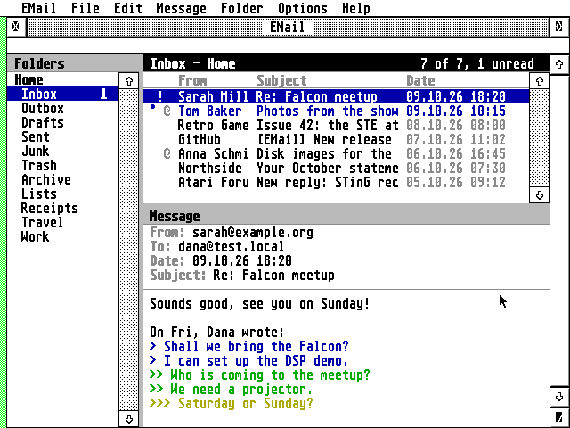
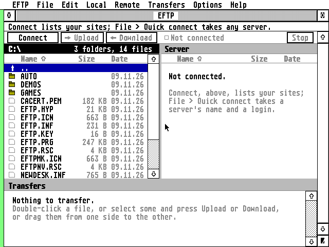
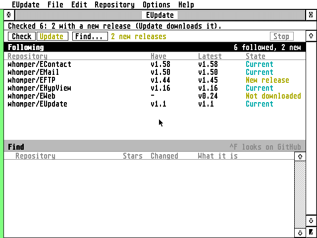
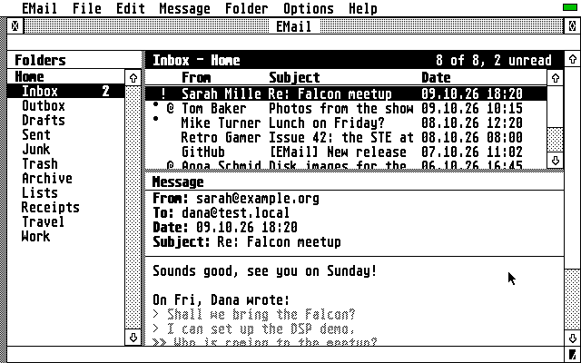


### 1.1 Parts, title, place
- **Parts.** Name, closer, fuller, mover, sizer, info line, and the AES's vertical slider column (`UPARROW |
  DNARROW | VSLIDE`): `MAINKIND` in EMail's, EFTP's and EUpdate's `win.c`, `KIND` in ECal's and EContact's.
  Where the content scrolls sideways, also `LFARROW | RTARROW | HSLIDE` (EWeb, EHypView's viewer). The iconifier
  (`SMALLER`) is added by `icon_kind()` where `appl_getinfo(11)` has it (AES 4.0 or the `?AGI` cookie). Leave
  out only what the app replaces with something it draws itself: **no info line** in EWeb and EPDF (their
  status bar at the foot of the window) and ClaudeST (status drawn in the sidebar's foot,
  `claudest.c:draw_status`). EPlay gets the fuller and the iconifier (D47). EConvert is a fixed form (B2, D34): name, closer, mover and the
  iconifier, no sizer or fuller (W13).
- **Title.** The name with one space each side, because the AES draws it flush to the edge: ` EMail `, ` EFTP `,
  ` EUpdate `, ` ECal `, ` EContact `, ` ClaudeST `, ` EPlay `. With a document or page: the name, " - ", the
  document: ` EWeb - PAGE TITLE ` (`eweb/ui/win.c:win_title`), ` EPDF - FILE ` (`epdf/src/gem/textwin.c:win_title`),
  EHypView ` DATABASE - PAGE ` (`view_title`). A helper window has its own name (EHypView's library `
  Hypertexts `, EMail's editor ` New message - ACCOUNT * `, the star while unsaved). An iconified ECal shows
  today's date as its title (`ecal/ui/win.c:win_title`, `icon_today`: "Oct 14"). No title carries the version
  (EConvert's does: W26); no app has "ECal - Work".
- **Info line = status line** (6.3). Its text starts with one space (`status()` in EMail, EFTP, EUpdate;
  `info_make` in ECal and EContact); empty means the line is empty, not a space. Hebrew is laid out visually
  before it is given to `wind_set_str(WF_INFO)` (`win.c:main_status`, `bidi_visual`), and the app sets it again
  only when the text changed (the AES redraws the line at every set).
  **Both stay: the info line, and an own status bar at the foot where the app has a progress line (5.9)** (EWeb,
  EPDF; Erez, 2 Nov: "Like EWeb, placed at the bottom"); ClaudeST's status stays in the sidebar's foot. Decided
  9 Nov 2026 (D40, W12).
- **Position and size** are saved in the INF and checked against the screen on the next start: the saved place
  is used when the window is at least the opening minimum wide and high and lies on the desk (`main_open`: `wd <
  40 * cw` etc.), else the app's default. A window shown as an icon does not save its place: it is read before
  `WF_ICONIFY` (`save_main_place`), and `WM_MOVED` of the icon only sets `WF_CURRXYWH`. The keys differ
  (W18): `MAIN=x,y,w,h` (EMail, EFTP, EUpdate), `WIN_X`, `WIN_Y`, `WIN_W`, `WIN_H` (ECal, EContact),
  `WINDOW=x,y,w,h` (EWeb, EPDF), `WINDOW=x,y` (EConvert); EPlay, EHypView and ClaudeST save no place. Panes:
  `PANES=a,b` (EMail, EFTP), `PANE=h` (EUpdate), `SIDEBAR=` (ECal, EContact: a switch; ClaudeST: a width). Font:
  `FONT=id,pt` (EMail, EFTP, EUpdate), `FONT_ID=` and `FONT_PT=` (ECal, EContact), `FONT=name,pt` (EPDF),
  `FONT=name` and `POINT=pt` as two keys (EHypView, which also has `PANECOLS=`; corrected 9 Nov). **One form:
  `WINDOW=x,y,w,h`, `PANES=`, `FONT=name,points`**, the focus apps now, the others when they next move their
  settings. An app that changes a key may read the old key once: the new key wins and only the new one is
  written (guidelines 6.1). Decided 9 Nov 2026 (D43, D44, W18).
- **Default place when there is no saved one** (W11): the whole desk (EMail, EFTP, EUpdate, EWeb, EPDF,
  ClaudeST); the desk less a twentieth of its width at each side and one text row above and below (ECal,
  EContact: `win_open`); EHypView's viewer centred across and 3/4 of the desk high with a third of the free
  height above it, each further viewer two text rows down and to the right; EPlay and EConvert centred across
  (EPlay with a third of the free height above it). **A main window first appears on the whole desk; a small fixed
  window is centred** (EPlay, EConvert). ECal, EContact and EHypView's first viewer change. Decided 9 Nov 2026 (D39,
  W11).
- **The work area sits on an 8-pixel grid** (the Speed rule: text on a byte): `wind_x8(kind, x, y, w, h)`
  (`common/atari/gem.c`) moves the window so that its work area starts at the nearest multiple of 8 (up to 3
  pixels left or 4 right; 8 more when that would cross the screen's left edge), and the app takes the width in
  by as much where the window would then pass the desk's right edge (`on_x8` EUpdate, `place8` EFTP, `place_x8`
  EMail, `x8_box` ClaudeST, `place` EPDF). Applied at open, `WM_SIZED`, `WM_MOVED`, `WM_FULLED` and EFTP's
  `WM_UNICONIFY`. **Text starts 8 pixels in** from a pane's or the window's edge, on a byte (`TEXT_X` in EMail's
  `ui.h`; `win_x0` in EFTP; one cell in EUpdate), columns are `cw` apart from there, and the same room is left
  at the right.
- **Minimum size** is enforced in `WM_SIZED` (cells of `cw` by `ch`): EMail 40 x 12 (editor 12 x 6), EWeb 40 x 12,
  ECal 40 x 14, EContact 44 x 12, ClaudeST 48 x 14, EFTP and EUpdate 50 x 16, EHypView's viewer 16 system-font
  cells wide and 6 rows plus its head high, EPDF 96 x 48 pixels. EPlay changes in whole rows only (at least 3
  list rows) and not in width. In EFTP, ECal and EContact the open check (`wd < 40 * cw` etc.) differs from the
  `WM_SIZED` minimum. **The sizes are content-bound** (an app's minimum is what its content needs), **a window with
  a toolbar is wide enough for its buttons** (EHypView does: `tb_full_width`), **and the open check uses the same
  number as `WM_SIZED`** (EFTP, ECal and EContact change). Decided 9 Nov 2026 (D38, W10).
- **Messages** every main window handles: `WM_REDRAW` through the AES rectangle list
  (`WF_FIRSTXYWH`/`WF_NEXTXYWH`, nothing drawn outside the work area), `WM_TOPPED`/`WM_NEWTOP` (`WF_TOP`; EMail,
  EFTP and EUpdate also act on the click that topped the window), `WM_CLOSED` (EFTP and EUpdate ignore it while
  a job runs: Stop first), `WM_FULLED` (full, or back to `WF_PREVXYWH` when already full, both snapped to the
  grid), `WM_SIZED`, `WM_MOVED`, `WM_BOTTOMED` (`WF_BOTTOM`), `WM_ARROWED`, `WM_VSLID`, `WM_ICONIFY`,
  `WM_ALLICONIFY`, `WM_UNICONIFY`. EWeb ignores `WM_SIZED` while a page loads ("the page being laid out keeps its
  width"); EHypView's library window has no `WM_BOTTOMED`.
- **Redraw** is from the AES rectangle list with the mouse hidden and `wind_update` held; a redraw is drawn
  whole in one piece (Speed); a scroll moves what stays (`scr_rows` / `vro_cpyfm`) and draws only the rows that
  come in.

### 1.2 Iconify (must, where the AES has it)
The iconified window shows the app's icon (the 16-colour picture with 16 colours or more, else the mono one),
centred, and under it a status in the 6 x 6 font when the work area is at least 40 pixels high and the text
fits (`common/ui/iconify.c:icon_draw`): ECal today's date ("Oct 14"), EContact the number of contacts ("621"),
EMail "N new" (none when nothing is unread), EFTP the running transfer's per cent ("45%"), EUpdate "busy" while
a job runs else "N new", EWeb "loading", EPDF the page ("3/8"), ClaudeST "busy" or "offline", EHypView nothing.
The icon takes no keys or clicks (`which &= ~(MU_KEYBD | MU_BUTTON)`: they are taken and dropped, not left in
the AES's buffer), and nothing is laid out for the small work area: the app lays out again at `WM_UNICONIFY`.
A page or file asked for (VA_START) brings an iconified viewer back (EHypView). `WM_BOTTOMED` sends the window
to the back. EPlay gets iconify code with its fuller (D47), and EConvert's fixed form the iconifier (D34, W13).

### 1.3 The AES's widgets (must; Erez, 24 Oct 2026)
The bullets of 5.1 stay (the AES's sizer; its sliders where the content scrolls as one; the right-edge pane
uses the AES's slider column; one click, one step). In detail, all in `common/ui/panebar.c`:
- A pane bar is as wide as the AES's slider column (`pb_width`: the larger of `graf_handle`'s box width and what
  `wind_calc` adds for `VSLIDE | UPARROW | DNARROW`, plus 1: 19 pixels TOS 1.04 ST high, 23 TOS 4 VGA, 20
  XaAES), its arrow boxes `pb_arrow_h` high (`graf_handle`'s box height), a bar across `pb_height` high. The
  slider is `track * shown / total` long, at least half an arrow box and 4 pixels. EUpdate's bar for a non-AES
  pane is `sbw + 1` wide, EFTP's and EMail's `sbw` (W28, one pixel).
- **Flat or 3D** by `win_look_3d()`: 3D only where the AES draws its own window widgets in 3D (MagiC, XaAES,
  N.AES, MyAES: `dlg_3d_ok() && dlg_3d_on && (aes_count() != 1 || MagX)`). A toolbar built of `G_BUTTON`s
  follows it (`dlg_3d(tool_tree)` in EFTP's `tool_layout`).
- **Clicks, as `pb_click` does them:** an arrow moves one row at the press and, held, after 250 ms some 15 rows
  a second (a slow machine takes bigger steps, up to 8 rows, rather than scrolling slower); a click in the
  track moves a page (`shown - 1` rows) and, held, repeats after 300 ms and then every 100 ms until the slider
  reaches the pointer; the slider is dragged with the pointer captured (`wind_update(BEG_MCTRL)`), polled every
  20 ms; the rest of the press does nothing until the button is up.
- **The window's own slider** of the pane at the right edge: `WF_VSLSIZE` = `rows * 1000 / total`, `WF_VSLIDE` =
  `top * 1000 / (total - rows)`, set only when they changed and, in EUpdate, a turn after the scroll
  (`win_sliders_owed`), because each `wind_set` makes the AES redraw the slider. `WM_ARROWED` and `WM_VSLID` scroll
  that pane, wherever the pointer is. Only EContact asks `graf_mkstate` and sends the list its arrows when the
  pointer is over the list (`win_message`), because some AESes send a wheel as `WM_ARROWED`.
  **No app handles a wheel message** (`WM_WHEEL`): the Speed table's "the wheel" is not met by any app.
  **No wheel is wanted unless Erez asks** (the Speed table no longer lists it). **One rule: the window's arrows
  scroll the pane under the pointer, else the slider's pane.** EContact does it today; the others change with a hub
  change in `common/`. Decided 9 Nov 2026 (D37, W9).
- **One click, one step** (28 Oct): the AES's second `WM_ARROWED` is dropped by `evnt_multi_`.

---

## 2. Panes and lists

### 2.1 Panes (EMail, EFTP, EUpdate, ClaudeST, EContact, ECal, EHypView's library)
- **Header strip.** `ch + 4` high above each list pane (EMail, EFTP, EUpdate): the title in bold at the left, 8
  pixels in; the pane's count or state at the right, right-aligned on a byte, in the dim colour (light text in
  mono), dropped whole (a trailing ", ..." part at a time in EFTP) when it does not fit; a 1-pixel rule along
  the foot. The pane with the keyboard has a dark strip (`P_HEAD`) and inverse text; the others `P_PANEL`. A
  click in a pane gives it the keyboard; **Tab** moves it to the next pane (EMail: folders, messages, message;
  EFTP: Atari, server, transfers; EUpdate: the other list).
- **Column titles** are the first row of a list's own area (`head_h`): bold in the dim colour (EMail, EFTP; plain
  dim in EUpdate; none in ECal and EContact) with a rule under them. In EFTP they sort (name, size, date; the
  sorted one has an arrow, `\x01` up or `\x02` down; a second click on the same column reverses, `opt.sort ^
  8`); in EMail and EUpdate they are labels only. **Column titles are bold dim everywhere a list has them** (EUpdate's
  plain dim changes); click to sort stays EFTP's. EPlay keeps its plain titles as part of design D (D42; `Still
  open`). Decided 9 Nov 2026 (D41, W15).
- **Divider.** `DIV` = 4 pixels (EMail, EFTP, EUpdate), filled `P_PANEL` in colour and dotted (`vsf_interior 2,
  style 4`) in mono, between panes; the pane bar of the pane beside it touches it, its frame being the edge
  (5.7). It can be grabbed 3 pixels either side of the drawn 4 (10 in all); over it the pointer is the flat
  hand (`FLAT_HAND`), in EFTP and EUpdate only while the window is on top and no job runs. A drag draws a
  1-pixel XOR line (the pointer held with `BEG_MCTRL`, polled every 10 ms) and nothing moves until the button is
  up; then `layout()` clamps and everything is redrawn. Clamps: panes at least `header + 3 rows` high; EFTP's
  and EMail's side panes at least 16 and 10 cells wide. Sizes go to the INF as pixels. Defaults: EMail folders
  `24 * cw + pb_width`, list 2/5 of the height; EFTP the two file panes half and half, the file panes 2/3 of the
  height; EUpdate the two lists half and half.
- **Panes meet with one line and a splitter is not a gap** (5.7): where a pane meets the window's edge, the
  window's own frame is the line; the 4-pixel splitter stays where panes can be dragged.
- **Sidebars:** ECal's calendar list 22 cells wide, at most a third of the window; EContact's groups 20 cells,
  at most a fifth, then the people 30 cells, at most 2/5 of what is left; ClaudeST's chats 30% of the width
  between 18 and 30 cells, 16 below 56 cells, dragged by its edge (`SIDEBAR=`). Shown and hidden by a button at
  the toolbar's left and **⇧^S** in ECal and EContact. **Every sidebar can be hidden with ⇧^S:** EMail's folder pane
  and ClaudeST's chat list gain it (new work, at a release the app makes anyway). Decided 9 Nov 2026 (D45, W20).

### 2.2 Lists

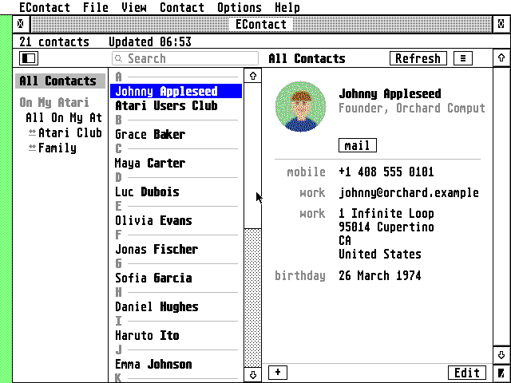
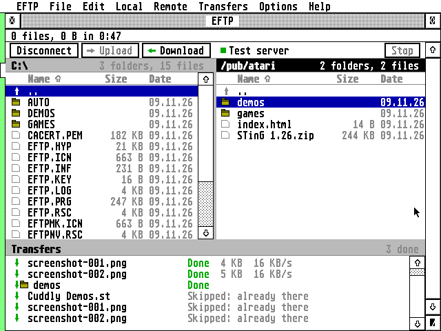


- **Rows** are `ch` high with no gap and no grid lines in EMail, EFTP and EUpdate; `ch + 2` in EContact's list
  and ECal's sidebar; `ch + 2` or `ch + 4` in ClaudeST; `ch + 4` in EPlay; two lines in EHypView's outline.
  **The row heights stay as listed.** Decided 9 Nov 2026 (D36, W8). Nothing in a row is bold or
  light unless it means something: a row's bold or light text cost a stock Falcon four times plain text
  (`eupdate/ui/lists.c:cell`).
- **Selected row:** the whole row width filled with `P_SEL` (a blue, 0 471 851 in 256 colours) and its text
  inverse (white); in mono black with white text. The selection does not change colour when its pane loses the
  keyboard. The row holding the keyboard cursor when it is not selected has a 1-pixel `P_SEL` frame while its
  pane has the keyboard (EFTP `files.c:draw`). Hidden files and similar are light.
- **Mouse** (timing: 5.8): a click selects the row; **Shift+click** adds or removes that row;
  **Control+click** adds the range from the last row clicked (the anchor) to this one (EMail, EFTP, EContact;
  `kstate & K_CTRL`; EUpdate has Shift only, ECal's lists have no multi-select: W7); a click on a row inside a
  selection of several keeps the selection (so it can be dragged; EMail shows its message again); a click
  below the last row does nothing (EFTP) or clears the selection (EUpdate); the right button selects the row
  (unless it is in the selection) and opens the context menu on press (3.3); a double click does the first
  context-menu entry; moving more than 4 pixels (`CLICK_SLOP`) with the button down is a drag (4.2), and the
  double click is timed from the desktop's speed (450, 330, 275, 220 or 165 ms, `click.c:press_dclick`).
- **Keyboard** in a list with the keyboard: **Up / Down** move the selection one row; **Shift+Up / Down** a page;
  **Clr/Home** the first row, **Shift+Clr/Home** the last (the Atari has no End); **Return** (and Enter) opens,
  as the double click does; **Insert** opens the context menu at the row in every app (EUpdate, ClaudeST and EPDF
  today; D17); in EFTP's file panes **Space** ticks the cursor's row and moves down (D16); **Delete** deletes;
  **Backspace** goes up a level (EFTP `..`, EUpdate back to the owners); a letter jumps to the next name
  starting with it (EFTP); **^A** selects all; **Tab** moves to the next pane; **Esc** in EFTP reads the lists
  again, elsewhere stops a running job. EContact's list has Home and Clr/Home but no Shift+Up/Down page, and EUpdate's neither
  (W6); EFTP's Shift page moves `rows` while its bars move `rows - 1`: one app, two sizes (W5, W6). A page is `rows - 1` rows (pane bar, EFTP, EUpdate, EPDF, ClaudeST, EContact's list); EMail's slider,
  EHypView and EPlay use `rows`; EWeb the page less 3 text lines (W5). Recommendation: `rows - 1`, so one line of
  context stays.
- **A player's exception** (EPlay, D53): Space is play/pause, Left and Right go ±10 s, ⇧Left and ⇧Right previous
  and next, `+` and `-` the volume, and **Clr/Home is Stop**, not the first row. Playback is not a job: Undo stops a
  load or a connection, and the Stop key stops playback (D54). EPlay's playlist gets multi-select (5.8; D21).
- **A window where a text field owns the keyboard** (ClaudeST's reply line; D46). The letters go to the field, and
  the list keys are these: **Tab** (and Shift+Tab) moves the list cursor; **Up and Down** (with Shift and Clr/Home)
  scroll the conversation; **Return on an empty field** opens the item; **Insert** opens its menu; Delete edits the
  field. **Esc stops what runs (a reply), leaves a search, else does nothing, and never empties the field**
  (Shift+Delete clears it). Decided 9 Nov 2026 (D46).
- **A choose mode** (EContact picking for EMail or ECal, the PEOPLE pick): the toolbar shows `[Cancel] [Choose]`; Esc
  empties the search and never cancels; Cancel or Undo ends the mode (D28).
- **Empty list:** one line of light text from the first row says why ("Choose a folder on the left." EMail,
  "Nothing found." EMail's Find, "Not connected." EFTP), never a blank pane.
- **Long names** cut by their column show whole in a tooltip (EMail `list.c:list_tip`, EFTP `files.c:tip`,
  ClaudeST `tip_text`).
- **Drag:** section 6.

### 2.3 Status line conventions (the info line, or the status bar where the app has one)
- One line, one leading space. Work under way: a verb phrase with "...", three spaces, and what stops it:
  `Connecting to HOST...   (Esc stops)`, `Looking for repositories on GitHub...   (Esc stops)` (EFTP `main.c`,
  EUpdate `main.c`, EWeb `main.c:say`). A job that moves bytes adds them: `NAME  12 KB of 3.4 MB   (Esc stops)`.
- A finished job: one sentence with a full stop: `Stopped.`, `3 files, 1.2 MB in 0:42  (29 KB/s)`, `Check 4: 1
  with a new release (Update downloads it).`, `Downloaded: it is current.`
- A command's confirmation: `Copied to the clipboard.` and, when it fails, `Couldn't write the clipboard.`
  (section 7).
- A pane's own count goes in that pane's header, not the info line: `N selected`, `3 folders, 8 files, 1.2 GB
  free` (EFTP), `12 of 40, 3 unread` (EMail), `2 followed, 1 new` (EUpdate).
- At rest the line is empty, or one hint (EFTP "Connect lists your sites; File > Quick connect takes any
  server."; EUpdate "Find on GitHub (^F) the repositories to follow."; EWeb "Secure: ..."). What needs an answer
  is an alert (6.2), not a status; what answers the user's own action is the status, never an alert or a
  notification (4.5).
- **Rate:** text that changes at every step is given to the AES at most every 250 ms (EUpdate `job_progress`) to
  400 ms (EFTP `progress_status`); EFTP puts the time left in the info line only every 10 seconds, because every
  set makes TOS's AES draw the line and TOS 4.04's AES crashed once in a download there (the Transfers pane
  keeps the time to the second).

---

## 3. The toolbar (guidelines 3.4)

- **The row.** `ch + 8` high at the top of the work area, white, with a 1-pixel rule under it. Buttons are `ch + 2`
  high, 3 pixels from the top, `(label characters + 2) * cw` wide, 2 pixels apart and one cell apart between
  groups; the first is 4 pixels in (ECal, EHypView, EWeb) or 8 (EFTP, EUpdate, EContact). The row's right end is
  kept clear for the Hebrew keyboard's badge (20 pixels, 5.3) and Stop sits left of it. Narrow windows use
  shorter labels (EFTP below 72 cells: "Open", "Close", "Up", "Down"; ECal below 70 cells: "D", "W", "M", "Y";
  EMail's editor below 52 cells) before a button is dropped (EHypView's `drop_order`: See also, Index,
  Bookmarks, Library, Home, Contents, <, >).
- **Buttons** are labels, not pictures, except EWeb's browser buttons (Back, Forward, Reload, Home, Search, Stop:
  30-pixel pictures in a 36-pixel button, flat until the pointer is over one, the name then on the status bar)
  and the drawn arrows of ECal's and EHypView's Back/Forward and EFTP's Upload/Download. **Built as
  `G_BUTTON`s of the AES** (5.6) in EFTP (`win.c:tool_layout`, drawn by `objc_draw`, pressed by
  `graf_watchbox`) and EConvert; hand-drawn (frame, label, inverse when pressed) in ECal, EContact, EHypView, EWeb, EUpdate and
  EMail's editor bar (W1). **Hand-drawn buttons are accepted** when they behave as the rule says (sink while held, act
  on release over them); **a new toolbar copies EFTP's AES buttons** (`eftp/ui/win.c:tool_layout`, `toolbar_click`).
  A hand-drawn button pressed while held draws between `press_update_begin()` and `press_update_end()`, because TOS's
  AES holds `BEG_UPDATE` back while the button is down (`tests/hatari/press_hold.py`; found in EContact and EHypView).
  EPlay's buttons are its own design. Decided 9 Nov 2026 (D33).
- **A button acts when the mouse is let go over it, and shows pressed meanwhile** (5.8): EFTP, ECal, EContact
  (since 1.76), EHypView (since 1.38, `press_track`), EWeb and EConvert (`dlg_win_button`). EUpdate's whole toolbar and
  EMail's editor bar act on the press after a flash (80 ms `evnt_timer_` in EUpdate): a deviation to fix (W1), and
  EUpdate's other buttons change to the release. **The one written exception is Stop in a job, which acts on the
  press:** EFTP, while a run goes, answers clicks only on Stop, and EUpdate keeps it. Decided 9 Nov 2026 (D32).
- **A button that opens a menu** (EFTP's Connect, EHypView's See also, Bookmarks and [≡], ECal's [≡]) opens it
  with `popup()` at the button's left edge, just below it (`popup(b->x, b->y + b->h, ...)`); EHypView's Back and
  Forward open the history on the right button, and the right button elsewhere on the bar opens the page's menu.
- **Disabled:** the AES's `DISABLED` (EFTP, the reference); frame and label in the dim colour (EUpdate); the label
  dimmed with a pattern (EHypView); ECal and EContact never disable a toolbar button, so W2 does not apply to them. A disabled button
  ignores clicks.
- **Stop** is the toolbar's last button at the right, enabled only while a job runs; Esc and Undo stop too.
  EFTP's is a `G_BUTTON` "Stop" with the tip "Stop the transfer (Esc)"; EUpdate's the same word in the error
  colour (`P_ERR`) when enabled, tip "Stop (Esc)"; EWeb's is a picture; EConvert's "Convert" button turns into
  "Stop" in place; EContact's modal box has "Cancel"; EMail, ECal and EHypView have Esc only.
  **The word is `Stop` for a job and `Cancel` only in a dialog;** EContact's modal box says Cancel today and
  changes. Decided 9 Nov 2026 (D31, W3).
- **The toolbar as it is in each app:**
  - ECal `[sidebar] [<] [Today] [>]  period title  [Day][Week][Month][Year] [+] [Refresh] [≡]`;
  - EContact `[sidebar] [search field]  name of the group  [Refresh] [≡]` ("Cancel" and "Choose" while picking
    for EMail or ECal);
  - EFTP `[Connect|Disconnect] [Upload] [Download]  ● server name ... [Stop]`;
  - EUpdate `[Check] [Update] [Find...]  "2 new releases" | "Following 5" ... [Stop]`;
  - EHypView `[<] [>] [house] [<] [Contents] [>] [Index] [See also] [Library] [Bookmarks] ... [≡]`;
  - EMail's editor `[Send] [Outbox]  [Attach...] [Address book...]`;
  - EMail's main window, EPDF, EPlay and ClaudeST have none; EWeb: `[Back] [Forward] [Reload] [Home] [Search]
    [Stop]`, the address field and the throbber (30 pixels).
  The `[≡]` (`\xF0`) button opens the app's menu, the only one an accessory's window has; its first entry is
  About (1.3).
- **A status note** beside the buttons is text, not a button: EUpdate's `2 new releases` (orange), `Following 5`,
  `Find a repository to follow`.
- **Tooltips:** [MENUS.md](MENUS.md) section 4 (every toolbar has them, from the shared `tooltip.c`, D18).

---

## 4. Fonts, text grid, colour roles (guidelines 5.3, the UI parts)

- **The system font** (`gl_wchar` x `gl_hchar`: 8 x 16 on ST high and VGA, 8 x 8 on ST medium) is the font of
  menus, dialogs, alerts, context menus, the AES's buttons and the About box. **Windows' content** (panes,
  headers, lists, toolbar labels drawn by the app) uses the chosen font's cell (`cw`, `ch`); EHypView's toolbar
  and tab strip stay in the system font (`font_sys_push` in `draw_bar`) while its page uses the chosen one.
- **Text goes on multiples of 8** across and is drawn through `text_at` / `text_n` / `text_plain`
  (`common/ui/text.h`): TOS draws the system font six times as fast there. Row text is plain; bold is for
  titles, column titles, the pane header and the current period (ECal "Today"); a selected row is inverse,
  never bold.
- **Roles of colour** (EMail, EFTP and EUpdate `theme.c`; `P_*`): `P_TEXT` near black, `P_DIM` slate grey for
  sizes, dates, column titles and counts, `P_LINE` rules and frames, `P_PANEL` light grey (dividers, idle
  headers, bar tracks), `P_HEAD` dark slate (the pane with the keyboard), `P_SEL` blue (the selection), and one
  or two meaning colours per app (EUpdate `P_NEW` orange and `P_OK` teal, EFTP `P_UP` terracotta and `P_DOWN`
  green, `P_ERR` red). **256 colours:** pens 16 and up set to these RGB values at start and put back at exit
  (`theme_init`, `theme_exit`). **16 colours:** the pen nearest by `pen_nearest`, never a fixed number (5.2).
  **Mono and 4 colours:** `P_PANEL` is pen 0, everything else pen 1, selection inverse. `COLOUR=0` turns colour
  off. Meaning is never colour alone: "Failed", "New release", "Waiting" are words as well.
  `theme.c` is the family's UI palette. ECal and EContact use the Mac palette on the standard pens, and
  EContact's `draw.c:sel_color` searches pens 2 to 255 for the colour nearest (120, 400, 880), against 5.2's
  rule; 16-colour `P_SEL` is (0,0,667) in EFTP and EUpdate and (0,0,533) in EMail. **`theme.c` is the family's palette,
  with one 16-colour selection colour, (0,0,667) as EFTP and EUpdate have it:** EMail changes, and the hub keeps the
  one `theme.c`. ECal and EContact keep their palette unless Erez says otherwise; EContact's `sel_color` reads pens 0
  to 15 when next touched (5.2). EPlay's design D (its own pens and selection, plain column titles) stays. Decided
  9 Nov 2026 (D42, W16).
- **The Hebrew keyboard's badge** sits: in EUpdate, EFTP, ECal and EContact at the toolbar row's right end
  (`hebrew_badge_right`); in EMail in the top-right pane's header strip (`win.c:top_right`), EMail having no
  toolbar; in EWeb at the status bar's right end; in ClaudeST at the right end of its reply field (and beside the fields of its text dialogs). EHypView,
  EPDF, EPlay and EConvert show none (no Hebrew keyboard in their windows: not in the code) (W23).

---

## 5. The About box (guidelines 1.3, must)

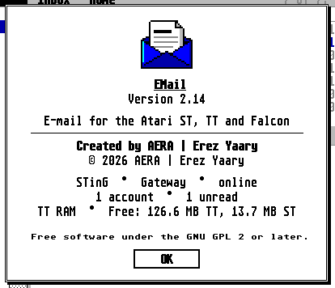
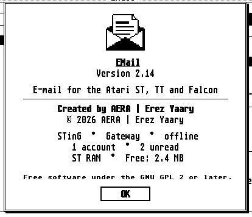


Every app has the same About box, drawn by `about_show()` (`common/ui/aboutbox.c`), in the system font, centred
on the **desk** (not the window), with a 3-pixel shadow; on a multitasking AES it is a window of the AES's
named "About NAME" (`dlg_open_area`). Rows, top to bottom, with `lh = ch + 1` (`ch + 2` where `ch` is 16) and a
gap `g` of half a line (halved until the box fits the desk):

```
              [ icon, 64 x 32 (ST medium) or 64 x 64 (ch 16): each pixel doubled across ]
                              ECal                     name, bold and underlined
                          Version 2.46
               A calendar for the Atari ST, TT and Falcon     tagline, at most 44 characters
          ------------------------------------------     rule, 4 cells in from each side
                    Created by AERA | Erez Yaary         bold
                      © 2026 AERA | Erez Yaary
               STinG  •  Direct  •  online               status line 1: the connection
               654 contacts in 2 address books           status line 2: the app's own
               TT RAM  •  Free: 98.2 MB TT, 3.1 MB ST    status line 3: the memory
        Free software under the GNU GPL 2 or later.      fine print, the small font (6 x 6 or 8 x 8)
        (up to three more fine-print lines of the app's: other people's credits)
                           [  OK  ]                      10 cells wide, `ch + 6` high
```

- **Size:** 50 cells wide, wider when a status line plus 4 cells, or a fine-print line, needs it (never past the
  desk less 2 cells). Name and version are `ABOUT.name`, `ABOUT.version`; the version line reads `Version X.Y`.
- **Icon:** in colour with 16 colours (`icon16_px`, pens 8 to 15 borrowed while the box is open and restored),
  256 colours (`icon256_px`, mapped to the pens that have those colours, none lent), else the mono `icon_bits`;
  drawn from ST RAM; the box is drawn off screen and shown whole (within 200 ms on an ST in colour, Speed).
  The picture is drawn at twice its width, not 32 x 32.
- **Closes** on Return, Esc, Space, Undo, Help or a click anywhere (`wait_close`). OK is drawn by the box, not a
  `G_BUTTON`.
- **The status lines say the same things in the same words** (connection, the app's own line, memory, from
  `common/ui/aboutline.c`; the bullet is `\xF9` with two spaces each side). An app with nothing to say on a
  line leaves it out (EHypView and EPDF have no connection line; EPlay has none yet though it has used the network since phase 7, and gets
  one; its own line is "Playing  •  OUTPUT" or "Not playing", then memory).
- **Fine print:** the licence line is the box's (`GPL_LINE`); an app adds at most three lines, and only for
  other people's work it must credit (EUpdate "Git logo by Jason Long, CC BY 3.0"; EWeb its libraries; EPlay's credits are in `NOTICES.TXT`, and "MP3
  decoded on the Falcon's DSP." is not a credit). No repository address.
- **Taglines** (one line, at most 44 characters): "E-mail for the Atari ST, TT and Falcon", "File transfer for
  the ST, TT and Falcon" (39 characters; Erez approved it for EFTP on 9 Nov, in EFTP's next release), "A calendar for ...", "Contacts for ...",
  "Hypertexts for ...", "PDF viewer for ...", "GitHub releases for the Atari Falcon and TT", "A web browser for
  the Atari Falcon", "An audio player for the Atari Falcon". **Fix both:** EFTP's is shortened to 44 characters or fewer,
  and EPlay's names the machines it runs on (it runs on the TT and STE as well). Each session sends Erez the wording
  to approve. Decided 9 Nov 2026 (D49, W22). Whether the article is the rule (it is sometimes there, sometimes not)
  is in `Still open`.
- **It opens from the first Desk-menu item** "About NAME..." (menu bar), or the first entry of the toolbar's [≡]
  menu where the window has no menu bar. Every edition can reach it (EConvert too).

---

## 6. Drag and drop (guidelines 4.2, should)

- **Windows accept `AP_DRAGDROP`** (MagiC, MiNT; the pipe `U:\PIPE\DRAGDROP.xx`): kinds `ARGS` (file names, quoted
  as for VA_START, read with `av_arg`) and `.TXT` (text, lines made `\n`). At most 32000 bytes (`DD_MAX`);
  longer is answered `DD_LEN`. Under single TOS the desktop's `VA_DRAGACCWIND` is accepted by an accessory's
  windows; the accessory tells the desktop about each window it opens and closes (`AV_ACCWINDOPEN`,
  `AV_ACCWINDCLOSED`: `av_window`), and the file names are taken as if they came with `VA_START` (4.1).
  `AV_STARTED` is sent back so the sender may let its copy go.
- **What an app does not take, it refuses** (`DD_EXT`, `DD_NAK`): `dd_message(msg, want, &d)` with `want` 0
  refuses everything, as EFTP, EUpdate and EWeb do from their job loops. A drop is answered at once and acted
  on once the loop is back.
- **The drop's position is not used:** an app takes the drop for the window, wherever in it (EFTP uploads to the
  server folder shown, whichever pane was dropped on).
- **What a drop does:**

| App | Drop files | Drop text |
|---|---|---|
| ECal | `.ics` imported (as VA_START) | a new event with that title |
| EContact | `.vcf` imported | not taken |
| EMail | attached to the message being written, or a new one | inserted at the cursor of the message being written, else a new message with it |
| EFTP | uploaded to the server folder shown (an alert when not connected; refused while transfers run) | not taken |
| EUpdate | not taken | a repository address: the Follow dialog |
| EHypView | `.HYP` opened | not taken |
| ClaudeST | attached to the next message | into the reply line |
| EWeb | the file opened (as VA_START: an address or a file) | not taken |
| EPDF | the first file opened | not taken |
| EPlay | added to the playlist; played if nothing plays | not taken |
| EConvert | added to the list of PDFs | not taken |

- **Drags the apps start (inside their own window only; nothing is dragged out to the desktop or another
  program: not in the code):** EFTP drags the selected files from one file pane to the other or to the Transfers
  pane; EMail drags messages onto a folder in its folder pane. Both start after the mouse has moved more than 3
  (EMail) or 4 (EFTP, `CLICK_SLOP`) pixels with the button down; the pointer is the flat hand; an XOR outline
  follows it (EMail 16 cells by one row, the target folder highlighted; EFTP the name or "N items", `(length +
  4)` cells up to 24, `ch + 4` high); letting go elsewhere does nothing (5.8). Recommendation: EFTP's threshold
  and outline for both (W21).
- Shared code: `common/ui/dd.c` (`dd_message()`, `dd_done()`), `av_window()` in `common/ui/av.c`.

---

## 7. Clipboard in the UI (guidelines 4.4)

- **Lists copy their selection's text form;** ^X and ^V do nothing there:
  - EMail: the message shown, or the folder's name.
  - EFTP: the chosen files' full names, a line each (`C:\FOLDER\NAME.TXT` here, `/folder/name` on the server);
    the cursor's row when none is chosen.
  - ECal: the event: title, when, where, notes.
  - EContact: "Name <email>", as EMail's To: line takes it; EContact's search field copies its text.
  - EHypView: the page as text; the library's search text.
  - EUpdate: the selected repositories' `owner/name`, a line each (CR LF); the Find list's `owner/name` or login.
  - EWeb: the selected text, else the page's text; the address field's text; a link's address.
  - EPDF: the page text (in slices, `clip_put_begin/step/end`; Esc and Undo give a copy up).
  - ClaudeST: Claude's last answer, from an empty reply line.
  - EPlay and EConvert: nothing today (whether EPlay's multi-selected playlist copies is in `Still open`).
- **After a copy the status line says it,** and says so when it failed: `Copied to the clipboard.` / `Couldn't
  write the clipboard.` (ECal, EContact, EMail, EFTP; EContact's failure is an alert). EMail's link copy says
  "The link is on the clipboard.", EWeb "The text selected is on the clipboard." / "The page's text is on the
  clipboard.", EHypView "The page is on the clipboard.", EPDF and ClaudeST a notice without the full stop,
  EUpdate nothing. **The words are `Copied to the clipboard.` / `Couldn't write the clipboard.`, on the status line in
  every app, never an alert.** Decided 9 Nov 2026 (D50, W17).
- **Notification button words** (4.5; W25): `Open|Later` (EMail, EUpdate), `Show|Later` (ECal), `Open`
  (EContact), `Show` (EFTP, EWeb, ClaudeST). **The first button reads `Show` when it brings a window forward, and `Open` for a
  thing (a message, a page);** EMail's `Open|Later` (a message) and ECal's `Show|Later` already fit, and EUpdate's
  `Open|Later` and EContact's `Open` become `Show`. Decided 9 Nov 2026 (D51, W25).
- **An Edit menu** is not required of every program with a menu bar: EContact has none, ECal's holds Copy event
  only, EPlay's is the playlist (4.4 reads "where it has text to cut, copy or paste").

---

## 8. Job windows (new guidelines 5.11)

A **job window** is a window, or a pane of one, whose work is a run of items done one after another and watched
by the user: EFTP's Transfers pane, EConvert's batch, EUpdate's checks and downloads. The family has five ways
of showing a job today; the first is the reference for anything that has a list of items. (Numbered 5.11
because 5.10 is "How a dialog is run", in [CONTROLS.md](CONTROLS.md).)

### 8.1 As built
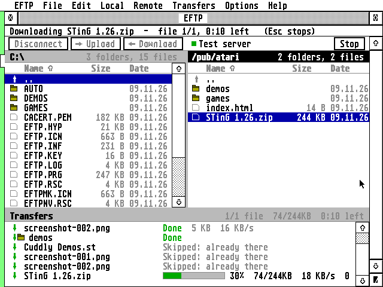
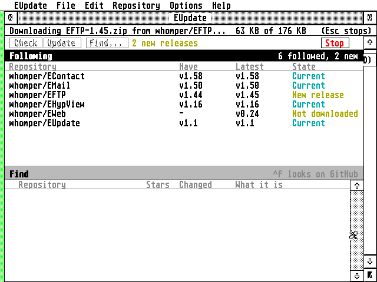
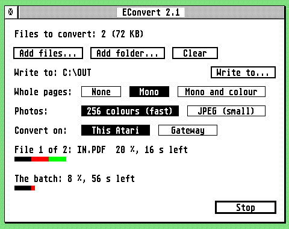


1. **EFTP's Transfers pane** (`eftp/ui/queue.c`, drawn in `draw_white`): a pane of the main window across the
   bottom, one row per item. This is the pattern for a list of items.
   - **Header strip** (`queue_titles`): "Transfers" in bold at the left. At the right, while a run is going `K/N
     files  DONE/TOTAL  M:SS left` (`3/12 files  1.4/6.2MB  2:10 left`: files started over files in the run, bytes
     in one shared unit, the time left of the whole run from the speed so far, where a row's own time is the file's;
     none in the first 3 seconds; D35 turns the time into `2 min left`); at
     rest only the non-zero parts of `N done, N waiting, N failed`, in that order. ^L swaps the pane for the
     server's messages (title "Server messages", info "^L: the transfers").
   - **Rows** are `ch` high, no title row (`head_h` = 2), text from `x0` = 8 pixels in. Columns, in cells from
     `x0`: **0** the direction arrow (`cw` wide, `ch - 4` high, 2 below the row's top; terracotta up to the
     server, green down to the Atari, black in mono, white on the selected row; drawn half a cell in); **3** the
     name (folders **4**, after a folder icon at 1.5 cells), `nw = cols * 2 / 5` cells wide, at least 12; **3 + nw +
     1** the state.
   - **States, in the state column** (dim only for `Waiting` (with its size, at +10 cells, for a file of known
     size only), `Skipped`, `Stopped` and `Done`'s size and speed; the running row's text is normal ink): `Waiting`,
     and at +10 cells the item's size. Running: a **bar** `bw` cells wide (16; a third of the state column when that
     has 40 cells or fewer), `ch - 4` high, 2 pixels from the row's top, track `P_PANEL` with a 1-pixel `P_LINE`
     frame, filled as far as `pct` with `progbar_fill`, in the shared colours (it is a bar per running row, kept by
     D48; it filled with the direction's colour until then); then one cell and `45%  100/200KB  1.2 MB/s  0:42 left`
     (per cent, done/total in one unit, speed, time left; the speed and the time appear after 200 ms and 2 s; D35
     turns the time into `42 s left`). A folder runs as `Listing the folder...` then `Making the folder...`. `Done`
     in green (`P_DOWN`), and at +6 cells `1.2 MB  29 KB/s` (a folder's Done has neither).
     `Failed: REASON` in red (`P_ERR`); `Skipped: REASON`; `Stopped at 1.2 MB` or `Stopped`.
   - **The running row stays in view** (`win_ensure_visible`) and is drawn again in place once a second, only
     from the state column on, off the screen and shown at once (`win_redraw_steady`, no flicker on a stock
     Falcon).
   - **Stop** is the last toolbar button, at the right, enabled only while the run goes, and it acts on the press
     (D32); Esc and Undo stop it too. A stopped run is `Stopped. Transfers > Retry goes on where it stopped.` on the info line.
   - **While it runs:** the info line shows `Uploading NAME  -  file 3/12, 2:10 left   (Esc stops)` (at most every
     400 ms; the time left only every 10 s). The app takes events between steps (`main.c:ui_poll`) but answers
     only some: the window is redrawn, moved, sized, full, iconified and brought up; `WM_ARROWED` and `WM_VSLID` are
     not answered, so no pane scrolls (a fault: D37); a menu click does nothing ("not now"; D19 greys the commands
     that would start another job instead); a drop is refused; clicks reach only Stop, and it acts on the press; all
     keys but Esc and Undo are dropped; Esc and Undo stop it (and an Esc held down does not stop the next thing: for
     a second after a stop they are ignored, `keys_flush`); the toolbar's other buttons are disabled; closing the
     window is ignored; `AP_TERM` stops the run and quits. A lost line is picked up
     again (reconnect up to twice, each file from where it got to).
   - **When it ends:** the info line says it in one sentence (`12 files, 6.2 MB in 3:12  (32 KB/s)  - some
     failed`), a bell after more than 30 s if the user set it, a notification (`Transfers done`, button `Show`,
     4.5) when it took more than 30 s and the window is behind another or an icon. No alert.
   - **Afterwards the rows stay** until the user clears them. Right-click: `Remove from the list  Del` (left out, not greyed, when nothing is
     selected and on the running row: it should be greyed, MENUS 3.2), `Retry the failed ones`, `Clear the finished
     ones`, `Clear the list` (each greyed when there is nothing to act on), and last `Show server messages  ^L`,
     which reads `Show the transfers  ^L` while the messages are shown. Delete removes the selected row, only when no
     run is going; Up and Down move the selection; the tooltip of a row is its path and its note. **Empty:** `Nothing to transfer.` and two lines
     of light text saying how to start one. **Iconified:** `45%` of the running file under the icon.
2. **EUpdate's info line** (`eupdate/ui/main.c`): the lists stay drawn and scroll while the job runs; only the
   commands are disabled. The toolbar's Check, Update and Find are disabled, the pointer is the busy bee, Stop (red label) is enabled, Esc and Undo stop, and the
   info line says what is done: `Asking GitHub for its latest release...   (Esc stops)`, then for a download
   `NAME  12 KB of 3.4 MB   (Esc stops)` at most every 250 ms and only for files of 16 KB or more
   (`job_progress`). The rows carry only the result, in one column and one colour each (`lists.c:state_of`):
   `Not checked` (dim), `No release` (dim), `Failed` (red; the row's tip says why), `Not downloaded` (orange),
   `Current` (teal), `New release` (orange). The summary is the info line (`Check 4: 1 with a new release
   (Update downloads it).`, `Update 2: 2 updated.`, `Stopped.`); a notification when a check by the schedule
   found something (`Open|Later`). Iconified: `busy`.
3. **EContact's progress box** (`econtact/ui/field.c:prog_open`, Sync Contact Photos): see CONTROLS.md section
   10; two lines of text (`12 of 340: Maya Carter`, then `About 4 minutes left`: hours, minutes, `About a minute
   left`, `Less than a minute left`; `Working out the time left...` for the first 4 s or 2 items; D35 turns these
   into `4 min left`), a framed bar (`ch` high, filled in the selection colour, to move to `progbar`) and **Stop**
   (it says Cancel today: D31); Esc and Undo stop it; it says `Stopping...`. The
   result is an alert (`N photos made.`), or a notification when the window is behind.
4. **EWeb's and EPDF's status bar** (`eweb/ui/win.c:draw_status`, `epdf/src/gem/textwin.c:bar_compose`): at the
   window's foot, `ch + 5` high (`ch + 7` where `ch` is 16), words on `ch` at 8 pixels in, a 1-pixel rule above,
   and the **5.9 progress line** along the foot (2 pixels, 3 where `ch` is 16) filling left to right, drawn only
   where it grew (EPDF at most every 250 ms). EPDF's words: `Viewing page 3 / 8 · Reading page 5 of 8 · 30% · 2
   min left` (the job's words come after half a second and go a third of a second after it ends; the separator
   is `\xFA`). EPlay's info line uses the same separator with two spaces each side (`Playing 2 of 6 · ...`).
5. **EConvert's window** (`epdf/src/econv/econvert.c`): see 8.3.

### 8.2 What the job windows have in common
- Esc and Undo stop the job, and there is a Stop button (EContact's box says Cancel today and changes: D31); the
  app stays usable (events are answered every 20 to 50 ms; long work in slices, Speed).
- **Keys typed while a job runs** (EUpdate reads them every 20 ms, EFTP between steps): Esc, Undo and Stop act; other
  keys and menu choices are read and dropped, and a drag-and-drop is refused; `AP_TERM` quits after the job.
- The result is in the status line, not an alert, unless something needs an answer (6.2). EContact's box and
  EConvert's end alert are the exceptions (W14).
- A job that took long and finished while the window was hidden is a notification (4.5): EFTP, EUpdate,
  EContact, EWeb; EConvert has none.
- 5.9's rule is one bar for the whole job, words beside it; EWeb and EPDF do it. **Two written exceptions:** EFTP
  keeps a bar per running row, drawn with `progbar` in the shared colours (D48), and EConvert keeps its two bars
  (D34). EContact's one bar in the selection colour moves to `progbar`, and EUpdate has no bar.
- **Formats** (W4). Per cent `45%` (EFTP, EPDF, EPlay) or `45 %` (EConvert). Time left `2:10 left`, `1:02:10
  left` (EFTP), `2 min left`, `20 s left`, `3 h` (EPDF `bar_compose`), `45 %, 2 min left` (EConvert), `About 4
  minutes left` (EContact). Sizes `980 B`, `12 KB`, `1.4 MB`, `120 MB` (EFTP `size_str`) or `980 bytes` (EUpdate
  `size_str`); the pair `100/200KB` in one unit (EFTP `pair_str`) or `12 KB of 3.4 MB` (EUpdate).
  **One set of formats in every job: per cent `45%`; time left `2 min left` (`20 s left`, `3 h`, as EPDF's
  `bar_compose` writes them); sizes `980 B`, `12 KB`, `1.4 MB` (EFTP's `size_str`) and done-of-total `12 KB of 3.4 MB`.**
  EFTP's `M:SS left`, EUpdate's `980 bytes`, EContact's `About 4 minutes left` and EConvert's `45 %` change. Decided
  9 Nov 2026 (D35, W4).

### 8.3 EConvert: B2 (decided 9 Nov 2026, D34)
**EConvert keeps B2:** Erez's choice of "B with the list management of A", a **fixed form** (an AES object tree with name,
closer, mover and the iconifier, no sizer or fuller) with **two bars**. The layout this file proposed here (a window
the user can size, a list pane like EFTP's, one bar in a status bar) is not adopted. 5.9 has a written exception for
EConvert's two bars. B2 is built on EPDF's unreleased `ui-family` branch; EPDF's session reports it as a per-file
list (a mark, the name, the size, the result), a state for each file, Remove and Delete, Settings under Options and
the iconifier.
- **It has (2.2, released):** Add files, Add folder, Clear; the output folder; the batch's three settings as AES radio
  buttons; a Convert button that becomes Stop; two bars (the file's and the batch's, `progbar_fill`) with `45 %, 2 min
  left` under each (D35 turns that into `45%, 2 min left`); Esc stops; files dropped (`dd_message`) and VA_START add to
  the batch; a failed file stays and the converted ones leave the list; the Gateway's three phases in the file's line
  (`Sending to the Gateway... 120 KB`, `The Gateway is converting...`, `Receiving from the Gateway... 80 KB`). Window:
  `NAME | CLOSER | MOVER`, fixed 58 x 21 cells of an AES object tree, title ` EConvert VERSION `, centred or at
  `WINDOW=x,y`; menus Desk, File, Help; keys ^O add, ^R convert, ^, settings, ^U and ^Q quit, Return converts, Esc
  stops, Help the guide.
- **B2 still lacks, by EPDF's list of 9 Nov** (D34 does not say whether they are wanted): the version in the title, an
  Edit menu, an info line, a notification when it finishes behind another window, a context menu and keys in the
  list; it ends with an alert, and `WM_MOVED` saves only x,y.
- **What D34 settles for the other rules:** no sizer or fuller (W13 is the iconifier only), Stop and Convert as one
  button that changes its word, the two bars (5.9's exception), Settings under Options (MD1). The older proposal's
  parts (a per-row state with a bar in the row, a batch bar in a status bar, a summary on an info line) are EFTP's and
  EPDF's patterns for a window that can be sized, and stay available for another job window.

---

## 9. Main windows, app by app

Cells of the app's font (`cw` x `ch`). "Pane bar" is `common/ui/panebar.c`; "AES slider" is `WF_VSLIDE`.

### EMail 2.14 (`ui/win.c`, `list.c`, `folders.c`, `reader.c`, `editor.c`)
| Part | As built |
|---|---|
| Window | `NAME CLOSER FULLER MOVER SIZER INFO UPARROW DNARROW VSLIDE` + iconifier; title ` EMail `; status on the info line; minimum 40 x 12 |
| Toolbar | none. (The editor window, kind without INFO, has `[Send] [Outbox]  [Attach...] [Address book...]`; tips name the key: `Send the message now (⇧^D)`) |
| Panes | **Folders** (left, full height, default `24 * cw + bar`), **Messages** (right, top, default 2/5 of the height) and **Message** (right, below). Dividers `DIV` 4, vertical and horizontal, both draggable, `PANES=` |
| Headers | `ch + 4` strips: `Folders`; `FOLDER - ACCOUNT` + `12 of 40, 3 unread` (offline: `3 unread  (offline)`); `Message` / the subject |
| Message list | rows `ch`; column titles `From` (`To` in Sent/Drafts), `Subject`, `Date`, bold dim, with a Find row above them (`ch + 8` high when on, `find.c`); unread in blue with a dot; flag/attachment marks; `Load more` row |
| Scrolling | folders and messages: pane bars; message pane: the AES slider (`WM_ARROWED` page = `rows`, not `rows - 1`) |
| Selection | click selects and shows the message in the next turns (not on release); Shift+click toggles, Control+click range; `N selected` in the header; Up/Down, Shift+Up/Down a page, Home/Shift+Home |
| Keyboard | Tab folders > messages > message; Delete deletes; Return reads |
| Drag | messages onto a folder (outline 16 x 1 cells, target highlighted) |
| Remembered | `MAIN=`, `PANES=`, `EDITOR=`, `FONT=`; iconified `N new`; Hebrew badge in the top-right pane's header |

### EFTP 2.2 (`ui/win.c`, `files.c`, `queue.c`, `main.c`)
| Part | As built |
|---|---|
| Window | as EMail; title ` EFTP `; minimum 50 x 16 (opens only if >= 40 x 16) |
| Toolbar | `ch + 8`: `[Connect\|Disconnect] [Upload] [Download]  ● SERVER \| Not connected ... [Hebrew badge] [Stop]`; AES `G_BUTTON`s; Connect opens a menu of the sites, `Sites... ^K`, `Quick connect...`; Upload/Download arrows in terracotta/green; tips `Connect to one of your sites, or close the connection (^D)`, `Copy what is selected on the Atari to the server (^T)`, `Copy what is selected on the server to the Atari (^T)`, `Stop the transfer (Esc)`; the dot is green when connected |
| Panes | **This Atari** (left) and **Server** (right) over **Transfers** (bottom); dividers 4 px; defaults half and half, files 2/3 high; `PANES=`; the larger of Server and Transfers has the AES slider, the others pane bars |
| Headers | `ch + 4`: path or `This Atari` + `3 folders, 8 files, 1.2 GB free`; path or `Server`; `Transfers` |
| File rows | `ch`; icon (drive, folder, file; 3 cells), name (right of it), size (7 cells, right-aligned, dim), date (`13.10.26 18:56`, 14 cells; 8 under 50 cells; hidden under 32); column titles bold dim `Name Size Date` sort on click; `..` row; hidden files light; cursor frame |
| Selection | click selects (press, drawn at once), Shift+click toggles, Control+click range, Space ticks and moves down, Insert opens the context menu (D16), letters jump, Return opens or transfers, Backspace up, Esc reads again, Tab to the next pane, Delete deletes (not in Transfers) |
| Job | Transfers pane, 8.1 |
| Remembered | `MAIN=`, `PANES=`, `SORT=`, `LOCALDIR=`, `FONT=`; iconified the running transfer's `45%` |

### EUpdate 2.0 (`ui/win.c`, `lists.c`, `main.c`)
| Part | As built |
|---|---|
| Window | as EMail; title ` EUpdate `; minimum 50 x 16 |
| Toolbar | `ch + 8`: `[Check] [Update] [Find...]  note ... [Hebrew badge] [Stop]`, hand-drawn, act on press after an 80 ms inverse flash; note `2 new releases` (orange) / `Following 5` / `Find a repository to follow`; tips `Ask GitHub for the latest releases of the repositories (^R)`, `Download the newer releases: of those selected, else of all (^D)`, `Find repositories by name, or owners and their repositories (^F)`, `Stop (Esc)` |
| Panes | **Repositories followed** (top) over **Find** results (bottom), divider 4 px, `PANE=`; the larger has the AES slider |
| Rows | `ch`; columns `Repository` (name, 12 to 30 cells), `Have` 12, `Latest` 12, `State` 15, `Folder` (the rest, if 12 or more); titles plain dim with a rule; state words and colours in 8.1 |
| Selection | click selects, Shift+click toggles (no Control range), double click opens Get info, Up/Down, Return, Delete (Unfollow), Insert (context menu), Tab to the other list; `repos_select_all` for ^A |
| Other | job: info line and Stop, 8.1; drop: text, a repository address; `MAIN=`, `PANE=`, `FOLDER=`, `FONT=`; iconified `busy` or `N new` |

### ECal 2.46 (`ui/win.c`, `sidebar.c`, `views.c`)
| Part | As built |
|---|---|
| Window | `KIND` as EMail; title ` ECal ` (the date when iconified); minimum 40 x 14; the AES slider scrolls the view |
| Toolbar | `ch + 8`: `[calendar-list icon] [<] [Today] [>]  PERIOD TITLE  [Day] [Week] [Month] [Year] [+] [Refresh] [≡]`; hand-drawn, pressed = inverse, act on release; the current view's button inverse; D W M Y under 70 cells; no tooltips on buttons |
| Panes | calendar list (22 cells, at most a third; account headers, a tick box in each calendar's colour, rows `ch + 2`; a small month below it, 21 cells wide) and the view; no divider; hide with the button or ⇧^S |
| Other | `WIN_X/Y/W/H`, `VIEW=`, `SIDEBAR=`, `FONT_ID=`, `FONT_PT=`; iconified the date `Oct 14`; tooltip on an event: title bold, when |

### EContact 1.82 (`ui/win.c`, `list.c`, `sidebar.c`, `card.c`)
| Part | As built |
|---|---|
| Window | `KIND` as EMail; title ` EContact `; minimum 44 x 12; the card has the AES slider |
| Toolbar | `ch + 8`: `[groups icon] [search field]  NAME OF WHAT IS SHOWN  [Refresh] [≡]` (`[Cancel] [Choose]` while picking); hand-drawn, act on release; no tooltips |
| Panes | groups (20 cells, at most a fifth, ⇧^S), people (30 cells, at most 2/5 of the rest, own pane bar, rows `ch + 2`), card |
| Selection | click selects (on press), Shift+click toggles, Control+click range, ^A, `N Cards Selected`; Up/Down one row, Home and Shift+Home the first and last, no page keys |
| Other | `WIN_X/Y/W/H`, `SIDEBAR=`, `SORT_FIRST=`, `FONT_ID/PT`; job: modal progress box; iconified the contact count |

### EHypView 1.39 (`src/gem/ehypview.c`, `toolbar.c`, `libwin.c`)
| Part | As built |
|---|---|
| Viewer window | `WKIND` with horizontal and vertical sliders; title ` DATABASE - PAGE `; info line the status or the hypertext's path; minimum width 16 system cells, height 6 rows + head; opens centred at 3/4 of the desk's height |
| Toolbar | `ch + 8` in the system font: `[<] [>] [house] [<] [Contents] [>] [Index] [See also] [Library] [Bookmarks] ... [≡]`; drawn arrows and house; hand-drawn, pressed inverse (`scr_xor`), act on release; buttons dropped in a fixed order when narrow; tips through BubbleGEM where it runs, else a box after 1 s |
| Tabs | a strip under the toolbar when more than one tab |
| Library window | ` Hypertexts `, `LKIND` without `WM_BOTTOMED`; outline or two panes (`LIBRARY=`, `PANECOLS=`), a search line, Up/Down/Left/Right |
| Remembered | the pages read last (`RECENT1=`...), `LIBRARY=`, `PANECOLS=`, `FONT=`; no window place |

### EWeb 0.81 (`ui/win.c`, `main.c`)
| Part | As built |
|---|---|
| Window | `NAME CLOSER FULLER MOVER SIZER` + 4 arrows and both sliders; **no info line**; title ` EWeb - PAGE `; minimum 40 x 12; several windows (`win_max`, ^N) |
| Toolbar | pictures `[Back] [Forward] [Reload] [Home] [Search] [Stop]` 36 px wide, address field, throbber 30 px; flat until hovered, name on the status bar |
| Page and status | line step 3 text lines, page = height less 3 lines; status bar at the foot, words + 5.9 line (8.1); `WINDOW=` (the window in front last); iconified `loading` |

### EPDF 2.1 (`src/gem/textwin.c`, `epdf.c`)
| Part | As built |
|---|---|
| Window | `NAME CLOSER FULLER MOVER SIZER` + vertical slider; no info line; title ` EPDF - FILE `; minimum 96 x 48 pixels; margin 8 px; no toolbar; status bar at the foot (8.1) |
| Keys | Up/Down a row, Shift+Up/Down a page (`rows - 1`), Space page down, Shift+Space up, Clr/Home start, Shift+Clr/Home end, ^Left / ^Right the previous / next page, Insert context menu |
| Remembered | `WINDOW=x,y,w,h`, `FONT=name,pt`; iconified `3/8` |

### EPlay 1.10 (`ui/main.c`, `bar.c`, `list.c`)
| Part | As built |
|---|---|
| Window | `NAME CLOSER MOVER INFO SIZER VSLIDE UPARROW DNARROW` (no fuller, no iconifier yet: both come with a saved place, D47); title ` EPlay `; 56 cells wide fixed, height in whole rows (list 3+ rows); mini player `NAME CLOSER MOVER` only; centred a third of the way down; **no place saved yet**; info line `Playing 2 of 6 · Falcon 49.1 kHz` |
| Bar | `4 * ch + 4` high, its own colours (pens 16 to 22, design D, Erez 3 Nov), its own drawn controls (Previous, Play/Pause, Next, position and volume; shuffle and repeat are in the Play menu and there is no Stop button), cover art |
| List | rows `ch + 4`; page = full rows |

EPlay's design D is Erez's decision of 3 Nov: its own palette (pens 16 to 22) and 56 columns wide. The hub read
EPlay's `DESIGN.md` on 9 Nov: line 1104 lists the iconifier and the fuller as the window's parts, and nothing in it
rules out a saved place. They are added (D47, W13); the palette and the fixed width stay (D42, W27).

### ClaudeST 2.1 (`st/claudest.c`)
| Part | As built |
|---|---|
| Window | `NAME CLOSER FULLER MOVER SIZER` + vertical slider and the iconifier (`icon_kind`, `SMALLER` on AES 4), no info line; title ` ClaudeST `; minimum 48 x 14; full desk, no place saved |
| Layout | sidebar (30% of the width, 18 to 30 cells, 16 below 56, dragged by its edge, `SIDEBAR=`, flat hand), rows `ch + 2` (`ch + 4` where `ch` is 16), conversation, title band `ch + 4/8`, reply line `ch + 6/10`; page = `rows - 1`; Insert opens the sidebar item's menu |

### EConvert (`epdf/src/econv/econvert.c`)
| Part | As built |
|---|---|
| Window | `NAME CLOSER MOVER`, fixed 58 x 21 cells made of an AES object tree; title ` EConvert VERSION `; centred or at `WINDOW=x,y`; menus Desk, File, Help (B2 on EPDF's `ui-family` adds the iconifier, a per-file list and Settings under Options: D34) |
| Controls | `Add files...`, `Add folder...`, `Clear`; `Write to...`; radio groups `Whole pages` None/Mono/Mono and colour, `Photos` 256 colours (fast)/JPEG (small), `Convert on` This Atari/Gateway; `Convert` (Stop while running); two bars; a count line |

---

## 10. Not in the code

- A mouse **wheel**: no `WM_WHEEL` handling anywhere in the apps or in `common/`, and none wanted (D37).
- **Shared tooltip code**: none in `common/` yet (hub work, D18).
- **Position memory** in EPlay (it is added: D47), EHypView, ClaudeST.
- **Tooltips** in EContact; toolbar-button tooltips in ECal (they come with the shared `tooltip.c`: D18).
- **A Hebrew badge** in the EHypView, EPDF, EPlay, EConvert windows.
- **Drag out of a window** to the desktop or another program (the apps only receive drops, except the two inside
  drags).
- **Sorting** by column in lists other than EFTP's file panes.
- **A dimmed selection when a pane loses the keyboard**: the selection looks the same; only the header changes.
- **A held-arrow rate for the AES's own window arrows**: the AES repeats them; the 15 rows a second is the pane
  bar's (`pb_click`).
- **A Falcon/ST-specific difference** in the layout: none; cells follow the font.

---

## 11. Still open

The answers of 9 Nov did not settle these; nothing here is guessed.

- **Further windows' first place** (D39). The rule is for a main window's first appearance; EWeb's ^N windows and
  EHypView's cascade (two text rows down and to the right) are not covered.
- **EPlay's column titles** (D41 against D42). D41 makes titles bold dim everywhere; D42 keeps EPlay's design D, whose
  titles are plain. The text keeps design D; Erez to confirm.
- **Which panes are a sidebar** (D45), and where EMail and ClaudeST put the hide command (neither has a View menu).
  EHypView's Subjects pane (the library's panes layout) is not named.
- **INF keys D43 does not name:** `PANECOLS=` (EHypView), `PANE=` (EUpdate: one pane's height), `SIDEBAR=` (a switch in
  ECal and EContact, a width in ClaudeST) and `HEBFONT=` (ClaudeST); and whether EHypView and ClaudeST, which save no
  window place, start saving `WINDOW=` (5.1 says a position is saved).
- **Job formats.** D35 gives `12 KB of 3.4 MB`; whether EFTP's narrow Transfers rows keep their `100/200KB` pair is not
  said.
- **A playlist's copy** (D21 against 7): whether EPlay's selected tracks copy to the clipboard. Today a list with text
  to copy copies it, and EPlay and EConvert copy nothing.
- **EConvert B2's remaining points** (above), and the About taglines' article (D49): whether "A calendar for ..." with
  the article, or "E-mail for ..." without, is the rule.
- **D46 and one-line fields.** D46 is written for the entry line of a window whose list shares the keyboard. A search
  field in such a window "leaves" the search on Esc; whether it also empties, as 3.5 says of a window's one-line field
  (EHypView's library search), is not said.
- **ECal's dialog tips** (500 ms) against the shared 0.7 s (D18).
